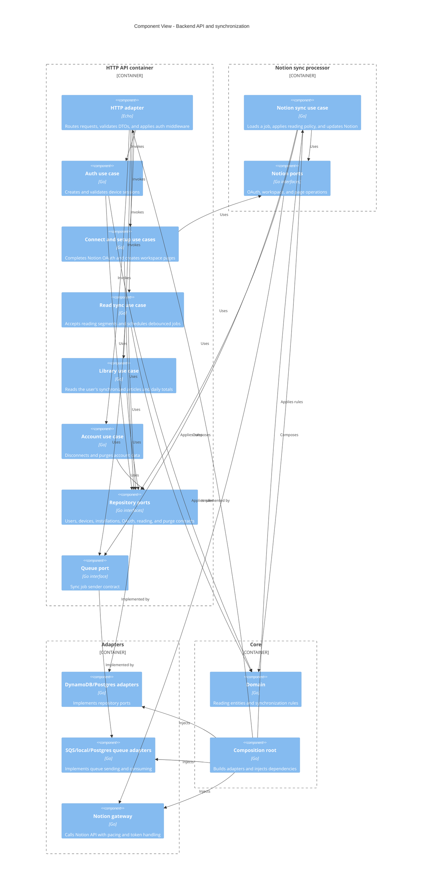

# Reading Tracker architecture (C4 model)

This document describes the Reading Tracker Chrome extension and Go backend using
the [C4 model](https://c4model.com/). Diagrams use Mermaid's C4 diagram syntax.

The system has two supported backend deployment modes:

- **AWS serverless:** API Lambda, worker Lambda, DynamoDB, and SQS.
- **Kubernetes:** `cmd/server` and `cmd/poller`, backed by Postgres and a
  Postgres-backed sync queue.

In both modes, the extension records active reading time locally and the backend
eventually updates the user's Notion workspace.

## 1. System context

The Reading Tracker system consists of the browser extension and its backend.
The user interacts with the extension while reading articles; Notion remains the
system of record for the user's library and daily reading log.

```mermaid
C4Context
    title System Context - Reading Tracker

    Person(reader, "Reader", "Reads articles and manages tracking settings")
    System_Boundary(readingTracker, "Reading Tracker") {
        System(extension, "Reading Tracker Chrome extension", "Measures active reading time, stores pending records locally, and syncs them")
        System(backend, "Reading Tracker backend", "Authenticates the extension, stores reading data, and synchronizes it to Notion")
    }
    System_Ext(browser, "Chrome browser", "Hosts the MV3 extension, content scripts, popup, and options page")
    System_Ext(notion, "Notion", "User workspace containing Library pages and Daily Log records")

    Person(reader) --> browser
    browser --> extension : Runs
    extension --> backend : HTTPS API\n(device token)
    backend --> notion : OAuth and HTTPS API
```

### Main flow

1. A content script observes supported article pages and measures active reading.
2. The service worker stores flushed reading segments in IndexedDB.
3. The service worker pushes pending records to the backend.
4. The backend persists the record and enqueues a debounced synchronization job.
5. A worker or poller consumes the job and updates the user's Notion pages.

## 2. Container view

The browser-side containers are bundled from `extension/src`:

- **Content script:** page-local DOM and visibility tracking; it does not
  access the API or IndexedDB directly.
- **Popup and options UI:** React pages for connection, library, and domain
  configuration.
- **Background service worker:** message routing, IndexedDB persistence,
  authentication, API calls, alarms, and synchronization scheduling.

The backend containers are implemented in `backend` and share the same use cases
and ports. The storage and queue containers vary by deployment mode.

```mermaid
C4Container
    title Container View - Reading Tracker

    Person(reader, "Reader", "Reads articles and configures the extension")
    System_Ext(notion, "Notion API", "OAuth provider and workspace API")

    System_Boundary(browser, "Chrome browser") {
        Container(content, "Content script", "TypeScript", "Detects supported articles and measures active reading")
        Container(ui, "Popup and options pages", "React + TypeScript", "Connection, library, and domain configuration")
        Container(worker, "Background service worker", "TypeScript + MV3", "Routes messages, persists records, calls the backend, and schedules sync")
        ContainerDb(indexedDb, "IndexedDB", "Browser storage", "Pending reading segments, device/session state, and cached configuration")
    }

    System_Boundary(backend, "Reading Tracker backend") {
        Container(api, "HTTP API", "Go + Echo", "Auth, Notion connection, setup, reading sync, library, and account endpoints")
        Container(sync, "Notion sync processor", "Go", "Consumes sync jobs, applies reading policy, and updates Notion")
        ContainerDb(store, "Application store", "DynamoDB or Postgres", "Users, devices, OAuth grants, installations, reading records, and sync state")
        Container(queue, "Sync queue", "SQS FIFO or Postgres queue", "Debounced, ordered Notion synchronization jobs")
    }

    Person(reader) --> content : Reads an article
    Person(reader) --> ui : Uses popup/options
    content --> worker : Chrome runtime messages
    ui --> worker : Chrome runtime messages
    worker --> indexedDb : Reads and writes
    worker --> api : HTTPS JSON API
    api --> store : Repository ports
    api --> queue : Enqueues debounced jobs
    sync --> queue : Consumes jobs
    sync --> store : Reads and writes sync state
    sync --> notion : Updates pages and daily logs
    api --> notion : OAuth and workspace setup
```

The API and sync processor do not call each other directly. The queue is the
boundary that makes Notion writes asynchronous and allows retry/dead-letter
handling.

## 3. Backend component view

The backend follows clean architecture. Dependencies point inward:
domain rules are independent, use cases depend on ports, and adapters implement
those ports. `internal/wire` is the composition root used by the command
packages.



The same use-case and adapter contracts are used in both deployment modes:

| Concern | AWS mode | Kubernetes mode |
| --- | --- | --- |
| API process | `cmd/api` in API Lambda | `cmd/server` |
| Sync process | `cmd/worker` in worker Lambda | `cmd/poller` |
| Store adapter | `internal/adapter/dynamo` | `internal/adapter/postgres` |
| Queue adapter | SQS FIFO | Postgres-backed queue |
| Infrastructure | Terraform resources | `backend/deploy/manifest.yaml` |

## 4. Deployment view

### AWS serverless deployment

```mermaid
C4Deployment
    title Deployment View - AWS serverless

    Deployment_Node(aws, "AWS account", "Managed AWS resources") {
        Deployment_Node(edge, "Public edge", "Lambda Function URL") {
            Container_Instance(apiLambda, "API Lambda", "Go + Echo", "Handles HTTPS API requests")
        }
        Deployment_Node(compute, "Lambda", "arm64, provided.al2023") {
            Container_Instance(workerLambda, "Worker Lambda", "Go", "Processes SQS sync jobs")
        }
        Deployment_Node(data, "Data services", "Managed AWS services") {
            ContainerDb(dynamo, "DynamoDB table", "Single table", "Application data and sync state")
            ContainerDb(sqs, "SQS FIFO queue", "FIFO + DLQ", "Debounced sync jobs")
        }
    }
    System_Ext(notion, "Notion API", "OAuth and page API")
    System_Ext(extension, "Chrome extension", "User-installed MV3 extension")

    Rel(extension, apiLambda, "HTTPS")
    Rel(apiLambda, dynamo, "Reads/writes")
    Rel(apiLambda, sqs, "Sends jobs")
    Rel(sqs, workerLambda, "Event source mapping")
    Rel(workerLambda, dynamo, "Reads/writes")
    Rel(workerLambda, notion, "HTTPS")
    Rel(apiLambda, notion, "OAuth/setup HTTPS")
```

The API Function URL is publicly reachable, but CORS is restricted to the
configured extension IDs and application authentication uses the device token.
Failed jobs are moved to the FIFO dead-letter queue after the configured retry
count.

### Kubernetes deployment

```mermaid
C4Deployment
    title Deployment View - Kubernetes with Postgres

    Deployment_Node(cluster, "Kubernetes cluster", "tuncloud") {
        Deployment_Node(namespace, "reading-tracker namespace", "Kubernetes namespace") {
            Container_Instance(server, "reading-tracker-server", "Go + Echo", "HTTP API on port 8080")
            Container_Instance(poller, "reading-tracker-poller", "Go", "Polls and processes the sync queue on port 8081")
        }
        Deployment_Node(database, "Postgres host", "Private network") {
            ContainerDb(postgres, "Postgres database", "Postgres", "Application data, migrations, and sync queue")
        }
    }
    System_Ext(ingress, "Ingress", "reading.tuando.app")
    System_Ext(extension, "Chrome extension", "User-installed MV3 extension")
    System_Ext(notion, "Notion API", "OAuth and page API")

    Rel(extension, ingress, "HTTPS")
    Rel(ingress, server, "Routes API traffic")
    Rel(server, postgres, "Reads/writes")
    Rel(server, poller, "Shares database-backed queue")
    Rel(poller, postgres, "Polls and updates")
    Rel(server, notion, "OAuth/setup HTTPS")
    Rel(poller, notion, "HTTPS")
```

The Kubernetes processes share the same Postgres database, but the API and
poller remain separate processes so API latency is independent of Notion API
work. Migrations are applied before the server and poller start.

## 5. Code map

| Area | Source |
| --- | --- |
| Extension entry points | `extension/src/content`, `extension/src/background`, `extension/src/popup`, `extension/src/options` |
| Extension persistence and API | `extension/src/background/db.ts`, `extension/src/background/api.ts`, `extension/src/background/sync.ts` |
| Backend HTTP adapter | `backend/internal/adapter/httpapi` |
| Backend use cases | `backend/internal/usecase` |
| Backend domain | `backend/internal/domain` |
| Storage adapters | `backend/internal/adapter/dynamo`, `backend/internal/adapter/postgres` |
| Queue adapters | `backend/internal/adapter/queue` |
| Notion adapter | `backend/internal/adapter/notion` |
| Composition roots | `backend/internal/wire`, `backend/cmd` |
| AWS infrastructure | `infra/terraform` |
| Kubernetes deployment | `backend/deploy/manifest.yaml` |

For behavior and operational procedures, see:

- [`extension/README.md`](../extension/README.md)
- [`backend/README.md`](../backend/README.md)
- [`infra/README.md`](../infra/README.md)
- [`runbook.md`](runbook.md)
