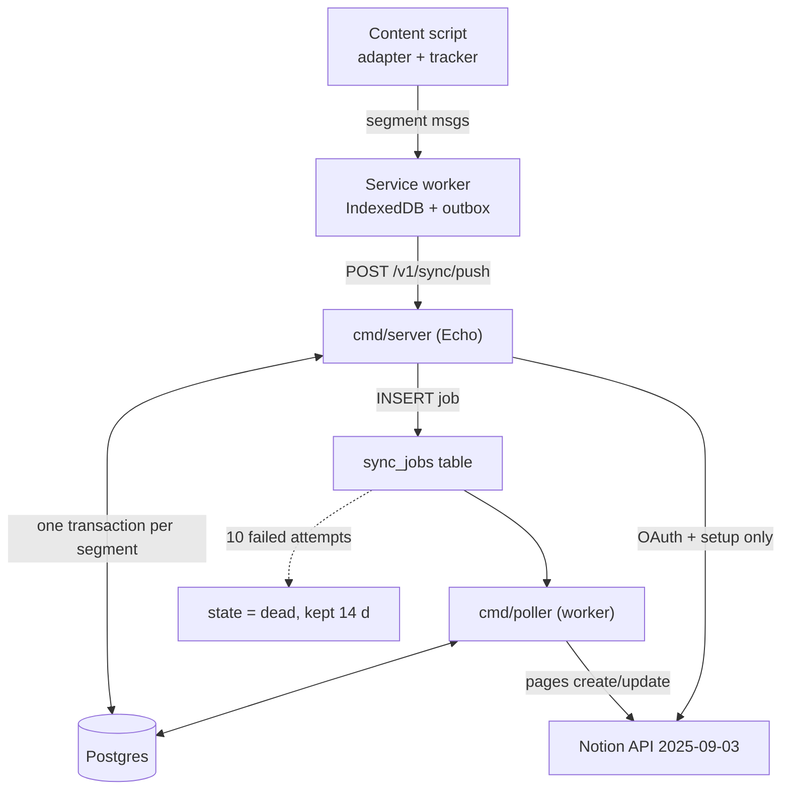

# Reading Tracker — Agent Spec

> **Context:** Chrome MV3 extension measures active reading time per article (Freedium/Medium first, any domain via a generic adapter), stores locally, and pushes batches to a Go backend on Kubernetes (an Echo HTTP server plus a poller process). The backend stores aggregates in Postgres and, through a Postgres-backed job queue (table `sync_jobs`), writes one page per article (+ one page per day) into the user's Notion workspace, connected via a **public Notion OAuth integration**. Sync is **one-way** (extension → backend → Notion). It runs on the operator's existing cluster and Postgres server, so it adds no separate infrastructure.
> **Rationale & mental model:** [`reading-tracker-onboarding.md`](./reading-tracker-onboarding.md).
> **Status:** Chosen, not built. **Items in §7 are NOT decided — do not hardcode them.**

---

## 1. System at a glance



**Key decisions (rationale in onboarding §1.3):**
- Library store → **Notion** (not Postgres/SQLite). (onboarding D1)
- Sync → **one-way**, no webhooks. (D2)
- Compute → **two long-running Go processes on Kubernetes (arm64)**: `cmd/server` (Echo HTTP API) and `cmd/poller` (Notion sync, called *the worker* below). Both apply pending migrations at startup; `cmd/migrate` applies them on its own. (D3)
- Entry → **Kubernetes Ingress** in front of `cmd/server`; CORS restricted to the allowed extension IDs. (D4)
- Server DB → **Postgres, one table per record type** (§3.1), schema in embedded SQL migrations. (D5)
- Notion rate limit + debounce → **Postgres job queue `sync_jobs`, `group_id = user#<user_id>`, bucketed dedup IDs, `run_at` delayed by D**. (D6, onboarding §4.3)
- Token encryption → **AES-256-GCM in app**, keys from the process environment (on the cluster: a Kubernetes Secret, §3.5). No KMS CMK. (D7)
- Deployment → **one Kubernetes manifest**, `backend/deploy/manifest.yaml`; the image is built and rolled out by `.github/workflows/backend-image.yml`. (D8)
- Notion → **public integration, OAuth 2.0, template duplication**; pinned `Notion-Version: 2025-09-03`. (D9)
- Notion properties are **server-owned XOR user-owned**; server never writes user-owned ones. (onboarding §4.2)
- One **active installation per user** in v1.

---

## 2. Interface / API contracts

### 2.0 Conventions

- Base URL: `${API_BASE}` (🔶 §7). All bodies JSON, UTF-8. Times RFC 3339 UTC.
- Auth (all endpoints except 2.1, 2.2, 2.3, 2.10): `Authorization: Bearer rt_<43 chars base64url>`.
- Error body (all non-2xx JSON responses):
```json
{ "error": { "code": "invalid_request", "message": "segments[3].active_seconds out of range" } }
```
| HTTP | `code` | When |
|---|---|---|
| 400 | `invalid_request` | validation failed |
| 400 | `invalid_grant` | bad/expired auth code or PKCE mismatch |
| 401 | `unauthorized` | missing/unknown/revoked device token |
| 404 | `not_found` | |
| 409 | `conflict` / `no_installation` | state conflict / user has no installation |
| 413 | `payload_too_large` | body > 256 KB or list limits exceeded |
| 503 | `capacity_exceeded` | the store was busy (Postgres serialization failure, deadlock, or the server refused a connection: too many connections, or still starting up) — for a push, every segment came back `retry`; client retries with backoff |
| 500 | `internal` | |

### 2.1 `GET /v1/oauth/notion/start`

Query: `ext_redirect=https://<ext-id>.chromiumapp.org/` · `code_challenge=<base64url(SHA-256(verifier))>` · `code_challenge_method=S256`

**Handler does**
1. Reject (400) unless `ext_redirect` host is `<id>.chromiumapp.org` with `<id>` ∈ `ALLOWED_EXTENSION_IDS`.
2. `state` = 32 random bytes, base64url. Insert an `oauth_states` row (§3.1) expiring in 600 s.
3. `302 Location: https://api.notion.com/v1/oauth/authorize?client_id=<NOTION_CLIENT_ID>&response_type=code&owner=user&redirect_uri=<urlenc(REDIRECT_URI)>&state=<state>`
   - `REDIRECT_URI` = `${PUBLIC_BASE_URL}/v1/oauth/notion/callback`; if `PUBLIC_BASE_URL` empty, derive from request `Host` (see C14).

### 2.2 `GET /v1/oauth/notion/callback`

Query: `code`, `state` — or `error=access_denied&state`.

**Handler does**
1. Consume the `oauth_states` row: delete it only if it exists and has not expired (C12). Missing → 400 HTML/text "Link expired, try again".
2. If `error` → `302 <ext_redirect>?error=<error>`.
3. `POST https://api.notion.com/v1/oauth/token`, header `Authorization: Basic base64(client_id:client_secret)`, `Notion-Version`, body:
```json
{ "grant_type": "authorization_code", "code": "<code>", "redirect_uri": "<REDIRECT_URI>" }
```
   Expected response fields used: `access_token`, `refresh_token`, `bot_id`, `workspace_id`, `workspace_name`, `workspace_icon`, `owner.user.id`, `owner.user.name`, `owner.user.person.email` (may be absent), `duplicated_template_id` (nullable), `expires_in` (if present).
4. Resolve user: `notion_user_links` row for `owner.user.id` → `user_id`, else create ULID `user_id` and insert the `users` row and its `notion_user_links` row (one transaction).
5. Upsert the `installations` row `<bot_id>` with tokens encrypted (AAD = `bot_id`), `status`, workspace fields; insert the `user_installations` (`<uid>`, `<bot_id>`) pointer; set `users.active_installation_id = bot_id`.
6. If `duplicated_template_id` → run **template resolution** (§2.11). Success → `status=active`; failure → `status=needs_setup`, `setup_error=<reason>`. No template → `needs_setup`.
7. If status became `active` → run **resync enqueue** (T22) for the user. It is a **full** resync (every article and day of the user, not only those whose `version` is ahead of `notion_synced_version`) when any of these holds: the Library or Daily data source differs from the one stored before this callback; the previous `setup_error` was `resync_failed`; or this installation was not the user's active installation before this callback (so switching back to an earlier installation resyncs everything). Connecting another workspace therefore brings the whole reading history into that workspace's databases; the pages already written to the old workspace are left in place.
8. `code` = 32 random bytes base64url. Insert an `auth_codes` row expiring in 120 s with `{user_id, installation_id, code_challenge, ext_redirect}`.
9. `302 <ext_redirect>?code=<code>`.

### 2.3 `POST /v1/auth/token`

**Request**
```json
{ "code": "Jx3…", "code_verifier": "dBjftJeZ4CVP-mB92K27uhbUJU1p1r_wW1gFWFOEjXk", "device_name": "MacBook Chrome" }
```
**Handler does**
1. Consume the `auth_codes` row (delete it only if it exists and has not expired, C12); missing → 400 `invalid_grant`.
2. `base64url(SHA-256(code_verifier)) == code_challenge` (constant-time) else 400 `invalid_grant`.
3. `device_id` = ULID; `token` = `"rt_" + base64url(32 random bytes)`; `hmac = hex(HMAC-SHA256(DEVICE_TOKEN_PEPPER, token))`.
4. Insert the `devices` row (`<uid>`, `<device_id>`) and the `device_tokens` row `<hmac>` in one transaction.

**Response** `200`
```json
{
  "device_token": "rt_q8V1…",
  "device_id": "01J9ZK6S8Y3W2E7Q4R5T6U7V8W",
  "user": { "id": "01J9ZK5…", "name": "Tuan Do" },
  "installation": {
    "id": "b7c1e0f2-…",
    "workspace_name": "Tuan's Notion",
    "status": "active",
    "library_url": "https://www.notion.so/2a1b…"
  }
}
```

### 2.4 Auth middleware (all authenticated routes)
1. Parse `Bearer rt_…`; compute hmac; `device_tokens` row `<hmac>` → `{user_id, device_id}`; absent or device `revoked_at` set → 401.
2. Load the `users` row (→ `active_installation_id`). Put both in Echo context.
3. Update `devices.last_seen_at` **at most once per hour** (guarded `UPDATE … WHERE last_seen_at IS NULL OR last_seen_at < now − 1 h`) — one write per device per hour, not one per request.

### 2.5 `GET /v1/me` → `200`
```json
{
  "user": { "id": "01J9ZK5…", "name": "Tuan Do" },
  "device": { "id": "01J9ZK6…", "name": "MacBook Chrome" },
  "installation": { "id": "b7c1…", "workspace_name": "Tuan's Notion", "status": "needs_setup", "setup_error": "template_not_found", "library_url": null }
}
```
`installation` is `null` if none.

### 2.6 `GET /v1/setup/pages?q=<text>` → `200`
Calls Notion `POST /v1/search` `{ "query": q, "filter": {"property":"object","value":"page"}, "page_size": 25 }`.
```json
{ "pages": [ { "id": "1f2e…", "title": "Reading", "url": "https://www.notion.so/1f2e…" } ] }
```

### 2.7 `POST /v1/setup`
**Request** `{ "parent_page_id": "1f2e…" }`
**Handler does:** 409 if installation `active`. Create **Reading Library** then **Daily Log** under the parent (schemas §3.3) via `POST /v1/databases`; resolve data source + property IDs; save; `status=active`; **full** resync enqueue for the user (every article and day).
**Response** `200` → same shape as `installation` in 2.5.

### 2.8 `POST /v1/sync/push`

**Request**
```json
{
  "client_time": "2026-10-06T03:12:00Z",
  "tz": "Asia/Ho_Chi_Minh",
  "articles": [
    {
      "canonical_url": "https://medium.com/p/8f3c2a1b9d4e",
      "source": "medium",
      "title": "Designing Idempotent APIs",
      "author": "Jane Doe",
      "site_name": "Better Programming",
      "word_count": 1820,
      "published_at": "2026-09-30",
      "original_url": "https://freedium-mirror.cfd/https://medium.com/better-programming/designing-idempotent-apis-8f3c2a1b9d4e"
    }
  ],
  "segments": [
    {
      "id": "6f1d2c9e-6a43-4b1e-9a0e-2f7c1d5b8e11",
      "session_id": "c3a9…",
      "seq": 0,
      "canonical_url": "https://medium.com/p/8f3c2a1b9d4e",
      "started_at": "2026-10-06T03:01:05Z",
      "ended_at": "2026-10-06T03:02:10Z",
      "active_seconds": 58,
      "max_progress": 0.42
    }
  ]
}
```

**Validation** (per item; invalid items go to `rejected`, request still 200 unless the envelope is invalid):
- Envelope: body ≤ 256 KB, `articles` ≤ 50, `segments` ≤ 50, `tz` loads via `time.LoadLocation` (else 400).
- `canonical_url`: absolute `https`/`http`, ≤ 2048 chars. `source` ∈ `[a-z0-9_-]{1,32}`. Strings trimmed; `title` ≤ 500, `author`/`site_name` ≤ 200 chars. `word_count` 0…200000.
- Segment: `id` UUID; `seq` ≥ 0; `1 ≤ active_seconds ≤ 3600`; `ended_at ≥ started_at`; `active_seconds ≤ (ended_at − started_at) + 5`; `0 ≤ max_progress ≤ 1`; `started_at` within [now − 30 d, now + 5 min]; `canonical_url` present in this request's `articles[]`.

**Handler does** (segments are written under the caller's `user_id`. The user must still have an installation, `users.active_installation_id`, whatever its status; none → 409 `no_installation`):
1. `url_hash = hex(SHA-256(canonical_url))[:32]`; `date = started_at` in `tz`, `YYYY-MM-DD`.
2. Per valid segment, **one** Postgres transaction (§3.2 "push transaction").
   - The segment row already exists (its insert affects no row) → `duplicate`.
   - Serialization failure or deadlock → the transaction is retried, at most 3 attempts in all, then `retry`. Other capacity errors (the server refused a connection: too many connections, or still starting up) → `retry`.
3. In the same transaction, the monotonic raise of `articles.max_progress` and `articles.last_read_at` (§3.2), also for a duplicate.
4. For each distinct `(url_hash)` and `(date)` touched by ≥1 accepted or duplicate segment (a duplicate re-enqueues because the push that committed it may have failed to enqueue): enqueue a job for the user (§2.12).
5. If every segment came back `retry` → 503 `capacity_exceeded`.

**Response** `200`
```json
{
  "accepted": ["6f1d2c9e-…"],
  "duplicate": [],
  "retry": [],
  "rejected": [ { "id": "aa11…", "reason": "active_seconds_out_of_range" } ]
}
```
Client marks `accepted ∪ duplicate` as synced; keeps `retry`; drops `rejected` (log locally).

### 2.9 `POST /v1/articles/status`
**Request** `{ "canonical_urls": ["https://medium.com/p/8f3c2a1b9d4e"] }` (≤ 100)
**Handler:** needs an installation (none → 409 `no_installation`) but looks the articles up by user: one query on `articles` for (`user_id`, `url_hash` ∈ the requested hashes), so it answers from the user's reading history whichever installation wrote it.
**Response** `200` (unknown URLs omitted)
```json
{
  "items": {
    "https://medium.com/p/8f3c2a1b9d4e": {
      "total_seconds": 734, "max_progress": 0.97, "sessions": 2, "completed": true,
      "last_read_at": "2026-10-06T03:20:00Z", "notion_url": "https://www.notion.so/9a8b…"
    }
  }
}
```

### 2.18 `GET /v1/history?tz=<IANA zone>&limit=<n>` → `200`
Auth: device token. It needs **a device, not an installation**: it answers the same way when the user's installation is `active`, `needs_setup`, `revoked` or absent, so a restore works right after a first connect. It never returns segments.

- `tz` (required): an IANA zone name that `time.LoadLocation` loads; `Local` is rejected. Missing or unknown → 400 `invalid_request`.
- `limit` (optional): absent → 50; above 100 → 100; not an integer or below 1 → 400 `invalid_request`.

```json
{
  "articles": [
    {
      "canonical_url": "https://medium.com/p/8f3c2a1b9d4e", "source": "medium",
      "title": "Designing Idempotent APIs", "author": "Jane Doe", "site_name": "Better Programming",
      "word_count": 1820, "published_at": "2026-09-30",
      "total_seconds": 734, "max_progress": 0.97, "last_read_at": "2026-10-06T03:20:00Z",
      "completed": true, "notion_url": "https://www.notion.so/9a8b…"
    }
  ],
  "today": { "date": "2026-10-06", "seconds": 1840 }
}
```
- `articles`: the user's articles, `last_read_at` descending, rows without a `last_read_at` last, ties by `url_hash` ascending; `[]` when there are none. `notion_url` is `null` until a page exists. The server keeps no original (pre-canonical) URL, so none is returned.
- `today`: `date` is the server clock's current date in `tz`; `seconds` is the stored `days.seconds` for that date (0 when the user has no row). Daily totals are dated in the time zone of the push that recorded them, so after the user changes time zone the figure can be off until the next day. That drift is accepted.

### 2.10 `GET /v1/config` (no auth) → `200`
```json
{
  "version": 1,
  "tracking": {
    "idle_seconds": 60, "segment_seconds": 60, "min_create_seconds": 30,
    "complete_progress": 0.9, "complete_time_ratio": 0.3, "words_per_minute": 230,
    "sync_interval_minutes": 2, "sync_threshold_segments": 20
  },
  "freedium_hosts": ["freedium-mirror.cfd", "freedium.cfd"],
  "strip_query_params": ["utm_*", "fbclid", "gclid", "mc_cid", "mc_eid", "ref", "source"]
}
```
Values come from embedded defaults, overridable by env `TRACKING_CONFIG_JSON`. All values 🔶 §7. Response header `Cache-Control: max-age=3600`.

### 2.11 Template resolution (internal, used by 2.2 and 2.7)
1. `GET /v1/blocks/{duplicated_template_id}/children` (paginate `start_cursor`) → blocks with `type=child_database`; match `child_database.title` exactly `"Reading Library"` and `"Daily Log"`.
2. For each: `GET /v1/databases/{id}` → `data_sources[0].id`; `GET /v1/data_sources/{ds_id}` → `properties` map.
3. Validate every property in §3.3 exists **by name with expected type**; store `props[logical_key] = property.id`.
4. Failure reasons (stored in `setup_error`): `template_not_found`, `database_missing:<name>`, `property_missing:<name>`, `property_type:<name>`.

### 2.12 Queue messages (`sync_jobs`)

| type | Body | `group_id` | `dedup_id` |
|---|---|---|---|
| article | `{"type":"article","user_id":"<uid>","url_hash":"<hash>"}` | `user#<uid>` | `article#<uid>#<hash>#<floor(unix/B)>` |
| day | `{"type":"day","user_id":"<uid>","date":"2026-10-06"}` | `user#<uid>` | `day#<uid>#<date>#<floor(unix/B)>` |
| purge | `{"type":"purge","user_id":"<uid>","installation_id":"<bot_id>"}` (`installation_id` omitted when the user has none) | `user#<uid>` | `purge#<uid>#<unix>` |

A job names the user, not an installation: the worker looks up the user's active installation when the job runs (§2.13 step 1), so a job survives a change of installation.

`B` = `DEBOUNCE_BUCKET_SECONDS`, `D` = `QUEUE_DELAY_SECONDS`; a job's `run_at` = enqueue time + `D`. **Require `D ≥ B` and `B ≤ 300`** (C5); also `D ≤ 900`. Both processes refuse to start otherwise.

- **Debounce:** a send whose `dedup_id` is already in the table is dropped (`INSERT … ON CONFLICT (dedup_id) DO NOTHING`). A job's row is deleted only when it is acked, which cannot happen before `run_at`, so with `D ≥ B` every push of one bucket lands while that bucket's job is still waiting, and collapses into it. Re-enqueues (resync on activation, the 404 case of §2.15) use a unique dedup id (`…#r<unix nanos>`), so they are never dropped.
- **Ordering (C4, C21):** the poller claims only the oldest non-`dead` job of a group, only once its `run_at` has passed, and only while no other job of the group holds a live lease. A claim leases the job for 6 minutes and increments `attempts`. Jobs of one user therefore run one at a time and in order; a failed or backed-off job blocks every job behind it in the group; different groups run in parallel.
- **Settling:** success → the row is deleted. Failure → the lease is released with `run_at = now + min(30 s × attempts, 5 min)`, or the Retry-After delay of §2.15. The 10th failed attempt marks the job `dead`: it stops blocking its group, keeps `last_error`, and is deleted after 14 days. A handler runs under a 60 s timeout; a lease that expires (crashed poller) makes the job claimable again.

### 2.13 Worker — `article` message
1. Resolve the user's active installation at run time: load the `users` row for `user_id`, then the `installations` row named by its `active_installation_id`. **Ack** (data stays stored; resync when an installation becomes active) when the user is missing or deleted, has no active installation, that installation is missing or `status != active`, or it belongs to another user.
2. Load the `articles` row (`user_id`, `url_hash`); missing → ack. Compute `completed` (sticky: once true stays true):
   `est = word_count / words_per_minute * 60`; `completed = stored.completed || (max_progress ≥ complete_progress && (word_count == 0 || total_seconds ≥ complete_time_ratio * est))`.
3. If no `notion_page_id`:
   - `total_seconds < min_create_seconds` → ack.
   - `POST /v1/data_sources/{library_ds_id}/query` with `{"filter":{"property":"<props.url>","url":{"equals":"<canonical_url>"}},"page_size":1}`; found → adopt its id/url.
   - else `POST /v1/pages` with `parent: {"type":"data_source_id","data_source_id":"<library_ds_id>"}`, **creation properties + server-owned metric properties** (§3.3), `children`: one `bookmark` block `{ "url": "<canonical_url>" }`.
   - Save `notion_page_id`, `notion_url`, `notion_ds_id` (the installation's Library data source).
4. Else `PATCH /v1/pages/{id}` with **server-owned metric properties only**.
5. `UPDATE articles SET notion_synced_version = :v, notion_synced_at = :now, completed = :c WHERE notion_synced_version IS NULL OR notion_synced_version < :v` (an older version never overwrites a newer one).

A row whose `notion_page_id` is set and whose recorded `notion_ds_id` differs from the installation's Library data source (its page lives in another workspace's or database's Library) has the page link cleared and the same message re-enqueued; the next run creates or adopts a page in the current Library (step 3). This is how the history reaches a newly connected workspace; the old page is left untouched.

### 2.14 Worker — `day` message
1. Resolve the user's active installation (as 2.13.1; the same cases are acknowledged). Load the `days` row (`user_id`, `date`); missing → ack.
2. Load the user's `articles` rows for `article_hashes` in one query → collect `notion_page_id`s (skip missing; cap 100).
3. No `notion_page_id`: query Daily Log by `Date` equals `date` → adopt, else create (`Name`=date, `Date`=date, `Minutes`, `Articles`).
4. Else PATCH `Minutes = round(seconds/60)`, `Articles` = page ids.
5. Save page id (and `notion_ds_id`, the Daily Log data source) + synced version.

As for articles, a `days` row linked to a page in another Daily Log data source has its link cleared and the message re-enqueued.

### 2.15 Worker — error handling (all Notion calls)
| Notion response | Action |
|---|---|
| 429 / 529 | release the job with `run_at = now + Retry-After + rand(0..3) s` (30 s when no `Retry-After`); the jobs behind it in the group wait (C21) |
| 5xx, network | fail the job (back-off `min(30 s × attempts, 5 min)`, §2.12) |
| 401 | refresh once (§2.16); retry call; refresh `invalid_grant` → `status=revoked`, ack |
| 404 / `archived` page | clear `notion_page_id`/`notion_url` on the `articles` (or `days`) row; re-enqueue same message type; ack |
| 404 / `object_not_found` on data source | `status=needs_setup`, `setup_error=database_missing:<name>`; ack |
| 400 `validation_error` | log body, ack (poison message) |

Pacing: ≥ 350 ms between Notion calls within one poller process.

### 2.16 Token refresh (worker only)
`POST /v1/oauth/token` Basic auth, body `{"grant_type":"refresh_token","refresh_token":"<rt>"}` → persist **new** `access_token` **and** `refresh_token` with `UPDATE installations SET access_token_enc, refresh_token_enc, token_version = :old + 1 WHERE id = :bot AND token_version = :old` (0 rows → the write lost).

### 2.17 Other endpoints
- `POST /v1/auth/logout` → set `devices.revoked_at` and delete the `device_tokens` row `<hmac>` (one transaction) → `204`.
- `DELETE /v1/me` → revoke all devices of user (delete their `device_tokens` rows), set `users.deleted_at`, enqueue `purge` (group `user#<uid>`) → `202`. Worker purge (skipped unless the user is marked deleted): for each of the user's installations, delete its `installations` row (one transaction each; an installation that now belongs to someone else is skipped); delete the user's `device_tokens` rows and `notion_user_links` row; then delete the user's `segments`, `articles` and `days` rows (by `user_id`) and their `devices`, `user_installations` and `users` rows (one transaction). Reading data belongs to the user, so it goes with the account; deleting an installation on its own deletes only that installation row and leaves the reading data. **Never deletes Notion content.**

---

## 3. Data model

### 3.1 Postgres tables
- Schema: `backend/internal/platform/pgmigrate/migrations/0001_store.sql` (store), `0002_sync_jobs.sql` (queue), `0003_reading_by_user.sql` (reading tables keyed by user) and `0004_sync_jobs_by_user.sql` (queued jobs rewritten to match), embedded in the binaries and applied forward-only at startup. All timestamps are `timestamptz` unless noted.
- **Ownership:** reading history (`articles`, `segments`, `days`) belongs to the **user**; it is keyed by `user_id` and survives a new Notion authorization. Tokens, status and the Notion database ids belong to the **installation**. The Notion link columns on `articles` and `days` (`notion_page_id`, `notion_url`, `notion_ds_id`, `notion_synced_version`, `notion_synced_at`) refer to the page in the database of the user's *active* installation.
- Expiring rows (`segments`, `oauth_states`, `auth_codes`) carry `expires_at`. The poller's housekeeping (at startup, then hourly) deletes rows with `expires_at < now`; until then they are still present, so every consume of `oauth_states`/`auth_codes` **must also check `expires_at > now`** (C12).

#### `users`
Key `id` (ULID). `notion_user_id`, `name`, `email?`, `active_installation_id?`, `created_at`, `deleted_at?`.

#### `notion_user_links`
Key `notion_user_id`. `user_id`. Resolves a Notion user to our user (§2.2 step 4); purge deletes it only while it still points at the purged user.

#### `user_installations`
Key (`user_id`, `installation_id`). `created_at` (pointer for purge/listing; a repeat insert keeps the first `created_at`).

#### `devices`
Key (`user_id`, `id`). `name`, `token_hmac`, `created_at`, `last_seen_at?`, `revoked_at?`.

#### `device_tokens`
Key `token_hmac`. `user_id`, `device_id`. Inserted with its `devices` row in one transaction; deleted on logout and account deletion.

#### `installations`
Key `id` (= Notion `bot_id`). `user_id`, `workspace_id`, `workspace_name`, `workspace_icon?`, `status` (`active`\|`needs_setup`\|`revoked`, enforced by a check constraint), `setup_error?`, `access_token_enc`, `refresh_token_enc`, `token_expires_at?` (text), `token_version` (int), `duplicated_template_id?`, `library_db_id?`, `library_ds_id?`, `library_url?`, `daily_db_id?`, `daily_ds_id?`, `props` (jsonb: logical_key → property id), `created_at`, `updated_at`.

#### `articles`
Key (`user_id`, `url_hash`). Index `articles_user_last_read` on (`user_id`, `last_read_at` DESC NULLS LAST, `url_hash`) serves the history endpoint (§2.18). `canonical_url`, `source`, `title`, `author`, `site_name`, `word_count`, `published_at` (text), `first_read_at`, `last_read_at`, `total_seconds` (bigint), `sessions` (bigint), `max_progress` (double), `completed` (bool, default false), `version` (bigint), `notion_page_id?`, `notion_url?`, `notion_ds_id?`, `notion_synced_version?`, `notion_synced_at?`.

#### `segments`
Key (`user_id`, `id`). `session_id`, `seq`, `url_hash`, `device_id`, `started_at`, `ended_at`, `active_seconds`, `max_progress`, `expires_at` = `started_at + 90 d` (indexed for the sweep).

#### `days`
Key (`user_id`, `date` — text `YYYY-MM-DD`). `seconds` (bigint), `article_hashes` (text[], each hash once), `version` (bigint), `notion_page_id?`, `notion_ds_id?`, `notion_synced_version?`.

#### `oauth_states`
Key `state`. `ext_redirect`, `code_challenge`, `expires_at` = now + 600 s. Single use: consumed by `DELETE … WHERE state = :s AND expires_at > now RETURNING …`.

#### `auth_codes`
Key `code`. `user_id`, `installation_id`, `code_challenge`, `ext_redirect`, `expires_at` = now + 120 s. Single use, consumed the same way as `oauth_states`.

#### `sync_jobs` (the queue, §2.12)
Key `id` (bigserial; orders the jobs of a group). `group_id`, `dedup_id` (unique), `body` (jsonb: the message of §2.12), `state` (`ready` | `leased` | `dead`, default `ready`), `run_at`, `attempts` (default 0), `leased_until?`, `created_at`, `last_error?`. Acked jobs are deleted; `dead` jobs are deleted after 14 days.

#### Migrations `0003` and `0004` (existing data)
- **`0003`** re-keys the three reading tables from `installation_id` to the `user_id` of the row's installation. A row whose installation no longer exists cannot be attributed and is dropped. Rows of one user for the same article (or day) merge into one: `total_seconds`, `sessions`, `seconds` and `version` are **summed**; `max_progress` and `last_read_at` take the maximum, `first_read_at` the minimum; `completed` is true if any was; `article_hashes` is the union (each hash once); the descriptive article columns come from the row with the earliest `first_read_at`. The Notion link columns are kept only from the row that belonged to the user's active installation; a row from any other installation, merged or not, loses its link (all NULL, also when the user has no active installation), so its next sync writes it into the active installation's databases. Summed versions stay above any `notion_synced_version` kept, so a merged row is synced again. A segment id present under several installations of one user is kept once. It also creates `articles_user_last_read`.
- **Known limitation, accepted:** `0003` merges by adding per-installation totals. If the same segment had been accepted under two installations of one user, its seconds are counted twice in the merged article and day totals.
- **`0004`** rewrites the queue (the two files are applied in order at the same startup). Article and day jobs whose installation no longer exists, and purge jobs with no `user_id`, are dropped (`dead` jobs are not touched, and are not rewritten). The other article and day jobs get `installation_id` replaced by the installation's `user_id` in the body, group `user#<uid>` and dedup id `mig4#<id>`; purge jobs only move to group `user#<uid>`. Every rewritten article/day job (unless it is leased) gets `run_at` of at least 15 minutes from now, so an old poller still running during the rollout does not acknowledge jobs it cannot read. Finally, every article and day whose `version` is ahead of `notion_synced_version` (rows the merge left pending have no job) gets a new job, dedup id `mig4#article#<uid>#<hash>` or `mig4#day#<uid>#<date>`, also held back 15 minutes.

### 3.2 Write rules

**Push transaction** (one per segment, C2):
```
INSERT INTO segments (…, expires_at = started_at + 90 d) ON CONFLICT DO NOTHING
-- only if that inserted a row (otherwise the outcome is `duplicate` and nothing is counted):
INSERT INTO articles (canonical_url, source, title, author, site_name, word_count, published_at,
                      first_read_at = :started_at, total_seconds = :as, sessions = :isFirst, version = 1)
  ON CONFLICT (user_id, url_hash) DO UPDATE
  SET total_seconds += :as, sessions += :isFirst, version += 1        (:isFirst = 1 if seq == 0 else 0)
INSERT INTO days (date, seconds = :as, article_hashes = {:h}, version = 1)
  ON CONFLICT (user_id, date) DO UPDATE
  SET seconds += :as, version += 1, article_hashes = append :h unless already present
-- always (also for a duplicate, so a lost raise heals):
UPDATE articles SET max_progress = GREATEST(COALESCE(max_progress, 0), :p),
                    last_read_at = GREATEST(COALESCE(last_read_at, 'epoch'), :e)
```
- A segment is applied exactly once: the increments run only when the segment row is new, in the same transaction as its insert. A segment id is unique per user, so the same id pushed again (from any device) is a `duplicate`.
- Article metadata and `first_read_at` are written only when the `articles` row is created; a conflict updates the counters only.
- `version` on `articles` and `days` goes up by one per applied segment; the worker records what it wrote in `notion_synced_version`, and resync (T22) picks rows whose `version` is ahead of it.
- `max_progress` and `last_read_at` only ever rise (`GREATEST`). A `:p` of 0 cannot win, so `max_progress` is left out of the update.
- `completed` is sticky: the worker writes `stored.completed || <rule>` (§2.13 step 2), and only through the version-guarded update of §2.13 step 5.
- `token_version` guards token writes (§2.16, C7): the update applies only when the stored version equals the one read before the refresh.
- Serialization failures and deadlocks retry the transaction (at most 3 attempts in all) and then return `retry`; connection exhaustion returns `retry` at once (§2.8).

### 3.3 Notion schema (template + `POST /v1/setup`)

**Reading Library** (data source):

| Logical key | Property name | Type | Owner | Written |
|---|---|---|---|---|
| `title` | `Name` | title | server | create |
| `url` | `URL` | url | server | create |
| `source` | `Source` | select | server | create |
| `author` | `Author` | rich_text | server | create |
| `site` | `Site` | select | server | create |
| `word_count` | `Word count` | number | server | create |
| `first_read` | `First read` | date | server | create |
| `last_read` | `Last read` | date | server | create + update |
| `minutes` | `Reading time (min)` | number | server | create + update (`round(total_seconds/60)`) |
| `progress` | `Progress` | number (format `percent`, value 0–1) | server | create + update |
| `sessions` | `Sessions` | number | server | create + update |
| `completed` | `Completed` | checkbox | server | create + update |
| — | `Tags` | multi_select | **user** | **never** |
| — | `Status` | status (`Not started`, `Reading`, `Done`, `Abandoned`, `Read later`) | **user** | **never** |
| — | `Rating` | select (`⭐`…`⭐⭐⭐⭐⭐`) | **user** | **never** |
| — | `Notes` | rich_text | **user** | **never** |

**Daily Log** (data source):

| Logical key | Property name | Type | Owner |
|---|---|---|---|
| `day_title` | `Name` | title (`YYYY-MM-DD`) | server |
| `day_date` | `Date` | date | server |
| `day_minutes` | `Minutes` | number | server |
| `day_articles` | `Articles` | relation → Reading Library data source | server |

Writes address properties **by stored property ID** (`props[...]`), not by name (C9). Select values for `Source`/`Site` are written by name (Notion creates missing options).

### 3.4 Extension local storage (IndexedDB via Dexie)
```ts
articles: { canonical_url (PK), source, title, author, site_name, word_count, published_at, original_url,
            total_seconds, max_progress, last_read_at }
segments: { id (PK), session_id, seq, canonical_url, started_at, ended_at, active_seconds, max_progress,
            synced: 0 | 1, created_at }          // index: synced, started_at
kv:       { key (PK), value }                    // device_token, device_id, installation, config cache,
                                                 // enabled_domains, denied_domains, sync_backoff_until,
                                                 // today_carry: { date, seconds }
```
Synced segments older than 30 days are deleted locally.

**Restore after connect.** After each successful connect the service worker calls `GET /v1/history` (§2.18; the device's time zone, limit 50) once, **before** the sync, and ignores a failure (it is logged; connecting is not blocked). It writes only to `articles` and `kv`, never to `segments`, so restored data is never pushed. The restore also runs once when the extension is updated and a device token is stored (after the startup sequence, then a sync).
- Merge per article, by `canonical_url`: `total_seconds` and `max_progress` take the larger of local and server (never the sum); `last_read_at` the later; `source`, `title`, `author`, `site_name`, `published_at`, `original_url` keep the local value when it is non-empty, else the server's (`original_url` falls back to the canonical URL); `word_count` keeps the local value when above 0. An article only the server has is stored as is.
- `today_carry` = `{ date, seconds }`: `date` is the date the server reported, `seconds` is how far the server's total for that date exceeds the sum of local segments that start on that date (in the device's time zone), never below 0. The popup adds `seconds` to today's local minutes only when `date` equals the device's current local date. Deleting the account clears the key.

### 3.5 Environment variables

| Var | Source | Used by |
|---|---|---|
| `APP_ENV` | ConfigMap | both |
| `DATABASE_URL` | Secret, `postgres://…` (pool size via `pool_max_conns`, default 5) | both |
| `NOTION_CLIENT_ID` | Secret | both |
| `NOTION_CLIENT_SECRET` | Secret | both |
| `NOTION_VERSION` | ConfigMap, `2025-09-03` | both |
| `NOTION_API_BASE` | optional, default `https://api.notion.com` (tests/local point it at a fake) | both |
| `TOKEN_ENC_KEYS` | Secret, `"v1:<b64 32B>[,v0:<b64 32B>…]"` — first = current | both |
| `DEVICE_TOKEN_PEPPER` | Secret, ≥ 32 random bytes b64 | server |
| `ALLOWED_EXTENSION_IDS` | ConfigMap, comma-separated | server |
| `PUBLIC_BASE_URL` | ConfigMap, may be empty (C14) | server |
| `DEBOUNCE_BUCKET_SECONDS` | ConfigMap, 1…300 (C5) | both |
| `QUEUE_DELAY_SECONDS` | ConfigMap, default = `DEBOUNCE_BUCKET_SECONDS`; `D ≥ B`, `≤ 900` | both |
| `TRACKING_CONFIG_JSON` | ConfigMap, optional | both |
| `LISTEN_ADDR` | ConfigMap, default `:8080` | server |
| `HEALTH_ADDR` | ConfigMap, default `:8081` | poller |
| `POLL_INTERVAL_SECONDS` | optional, default `1` | poller |

On the cluster, the ConfigMap and Secret are in `backend/deploy/manifest.yaml`; locally all of them come from `backend/.env.local` (`make .env.local`).

---

## 4. Implementation plan

### 4.1 Suggested structure
The as-built backend layout is in [`backend/README.md`](../backend/README.md) → "Architecture".
```
reading-chrome-extension/
├── docs/                         # these specs
├── extension/
│   ├── manifest.config.ts        # MV3 manifest (crxjs or vite-plugin-web-extension)
│   ├── src/
│   │   ├── adapters/             # types.ts, freedium-medium.ts, generic.ts, registry.ts
│   │   ├── lib/                  # normalize-url.ts, uuid.ts, api.ts, pkce.ts
│   │   ├── content/              # tracker.ts, index.ts
│   │   ├── background/           # db.ts (Dexie), sync.ts, auth.ts, messages.ts, index.ts
│   │   ├── popup/
│   │   └── options/
│   └── test/
├── backend/
│   ├── cmd/server/main.go        # Echo on LISTEN_ADDR (API process)
│   ├── cmd/poller/main.go        # sync_jobs poller (Notion sync)
│   ├── cmd/migrate/main.go       # applies the SQL migrations and exits
│   ├── internal/config/
│   ├── internal/crypto/          # keyring (AES-GCM), token hmac, pkce
│   ├── internal/store/           # Postgres repos, push transaction, migrations
│   ├── internal/notion/          # thin client + typed errors
│   ├── internal/httpapi/         # echo app, middleware, handlers
│   ├── internal/syncsvc/         # push validation + aggregation
│   ├── internal/queue/           # sender, poller + dedup ids
│   ├── internal/worker/          # article, day, purge handlers
│   ├── deploy/manifest.yaml      # Kubernetes manifest
│   └── Makefile                  # pg-up, run, test, image (Podman, linux/arm64)
```

### 4.2 Tasks

**Backend (Go)**
- [ ] **T8 — Config.** Parse/validate env (§3.5); fail fast on missing; parse `TOKEN_ENC_KEYS`; embed default tracking config; `import _ "time/tzdata"`.
  - *AC:* unit test: missing `DATABASE_URL` → error; `QUEUE_DELAY_SECONDS` below `DEBOUNCE_BUCKET_SECONDS` or above 900, or `DEBOUNCE_BUCKET_SECONDS` above 300 → startup error (C5); `time.LoadLocation("Asia/Ho_Chi_Minh")` works without system zoneinfo (the distroless image has none).
- [ ] **T9 — Crypto.** Keyring `Seal(plain, aad) → "<ver>:<b64(nonce‖ct)>"`, `Open`; token HMAC; PKCE S256 verify (constant-time).
  - *AC:* round-trip test; `Open` with different AAD fails; ciphertext from `v0` opens after `v1` is prepended; tampered byte fails.
- [ ] **T10 — Store.** Typed repos for every table in §3.1, push transaction (§3.2), capacity-error classification (serialization failure, deadlock, connection exhaustion → `retry`/503).
  - *AC:* integration test on a local Postgres: pushing same segment twice → aggregates incremented once; `max_progress` never decreases.
- [ ] **T11 — Notion client.** Endpoints: oauth token (code + refresh), search, blocks children (paginated), databases get/create, data_sources get/query, pages create/update. Sets `Notion-Version`. Typed error `{Status, Code, RetryAfter}`.
  - *AC:* `httptest` server tests: 429 with `Retry-After: 2` → error with `RetryAfter=2s`; header `Notion-Version: 2025-09-03` present on every request.
- [ ] **T12 — Echo app.** Router `/v1`, error format §2.0, request body limit 256 KB, auth middleware §2.4, request logging (no tokens/bodies), `cmd/server`.
  - *AC:* `make run` serves `/v1/config`; unauthenticated `GET /v1/me` → 401 JSON error shape.
- [ ] **T13 — OAuth start + callback** (§2.1, §2.2).
  - *AC:* unknown extension id → 400; reused `state` → 400; happy path (Notion mocked) → 302 to `https://<id>.chromiumapp.org/?code=…` and the `installations` row stored with encrypted tokens (no plaintext token in the row).
- [ ] **T14 — `POST /v1/auth/token`** (§2.3).
  - *AC:* wrong verifier → 400 `invalid_grant`; code usable once; token stored only as HMAC.
- [ ] **T15 — Template resolution + setup endpoints** (§2.6, §2.7, §2.11).
  - *AC:* template missing `Progress` → `needs_setup` with `setup_error=property_missing:Progress`; `POST /v1/setup` creates both DBs (mocked) and flips to `active`.
- [ ] **T16 — `POST /v1/sync/push`** (§2.8).
  - *AC:* response classifies accepted/duplicate/retry/rejected correctly in tests; one article + one day message sent per distinct key; `date` computed in request `tz` (segment at `2026-10-05T18:30Z` with `Asia/Ho_Chi_Minh` → `2026-10-06`).
- [ ] **T17 — `GET /v1/me`, `POST /v1/articles/status`, `GET /v1/config`, `POST /v1/auth/logout`.**
  - *AC:* logout then any call with same token → 401; status for 100 URLs uses one `articles` query.
- [ ] **T18 — Queue sender.** Dedup ID builder per §2.12; `sync_jobs` insert that drops a known `dedup_id`.
  - *AC:* two sends for same article within one bucket produce identical dedup IDs; different buckets differ.
- [ ] **T19 — Worker: article** (§2.13).
  - *AC:* total below `min_create_seconds` → no Notion call; existing page found by URL query → adopted, not duplicated; PATCH body contains only server-owned metric property IDs.
- [ ] **T20 — Worker: day** (§2.14).
  - *AC:* Minutes = round(seconds/60); relation only includes articles with a page id.
- [ ] **T21 — Worker: errors + token refresh** (§2.15, §2.16). A failed job blocks the later jobs of its group (§2.12).
  - *AC:* 429 → the job's `run_at` is pushed back ≥ Retry-After; refresh stores **both** new tokens and bumps `token_version`; `invalid_grant` → `revoked`; archived page → page id cleared + re-enqueued.
- [ ] **T22 — Resync on activation.** When an installation becomes `active`, select the user's `articles` rows with `version > notion_synced_version` (or never synced) — all of them when the resync is full (§2.2 step 7, §2.7) — and enqueue `article` for each; same for `days`.
  - *AC:* after needs_setup → active, all pending articles appear in Notion without new pushes; after connecting another workspace, every article and day of the user appears in the new databases.
- [ ] **T23 — Account deletion + purge** (§2.17).
  - *AC:* after `DELETE /v1/me` and worker run, no row for `<uid>` or `<bot_id>` remains in any §3.1 store table; Notion untouched.

- [ ] **T33 — `GET /v1/history`** (§2.18).
  - *AC:* answers 200 for a user whose installation is absent, `needs_setup` or `revoked`; `tz` missing, unknown or `Local` → 400; `limit` absent → 50, 500 → 100, `0` or `abc` → 400; articles ordered by `last_read_at` descending with unread-time rows last; `today.seconds` equals the `days` row of today's date in `tz`.

**Notion**
- [ ] **T24 — Template page.** Public Notion page containing `Reading Library` and `Daily Log` exactly per §3.3, with views: "Reading now" (Status = Reading), "This week" (Last read within past week), "Completed", "Top rated" (Rating ≥ ⭐⭐⭐⭐), board by Status, gallery by Source; Daily Log bar chart of Minutes by Date. Configure its URL in the integration settings.
  - *AC:* OAuth with "duplicate template" yields `status=active` with no `setup_error`.

**Extension (MV3 + TypeScript + Vite)**
- [ ] **T25 — Scaffold.** Manifest: `permissions: ["storage","alarms","identity","scripting"]`, `host_permissions`: Freedium hosts, `https://medium.com/*`, `${API_BASE}/*`; `optional_host_permissions: ["https://*/*"]`; `"incognito": "not_allowed"`; `API_BASE` from `VITE_API_BASE`.
  - *AC:* `npm run build` produces a loadable unpacked extension; no `<all_urls>` in required permissions.
- [ ] **T26 — URL normalization + adapters.**
  - `normalizeUrl`: lowercase host, drop fragment, drop params matching `strip_query_params` (glob `utm_*`), drop trailing slash (except root), force `https` when the site serves https.
  - `freedium-medium` adapter: matches Freedium hosts (from config) and `medium.com`/`*.medium.com`. Canonical: if Freedium path starts with `/http`, the remainder is the original URL; extract Medium post id `/-?([0-9a-f]{10,16})$/` from the last path segment → `https://medium.com/p/<id>`; else fall back to `link[rel=canonical]` → `og:url` → normalized location. Metadata: title (`h1` / `og:title`), author, site/publication, word count from content root text. `original_url` = location.
  - `generic` adapter: only on user-enabled domains. Canonical: `link[rel=canonical]` → `og:url` → location, then normalize. Metadata: JSON-LD `Article`/`BlogPosting` (`headline`, `author.name`, `datePublished`, `wordCount`) → OpenGraph → `<meta name=author>`; content root `article` → `main` → `body`.
  - *AC:* unit tests: `https://freedium-mirror.cfd/https://medium.com/better-programming/designing-idempotent-apis-8f3c2a1b9d4e?source=x` → `https://medium.com/p/8f3c2a1b9d4e`; `https://medium.com/@jane/foo-8f3c2a1b9d4e` → same canonical; `https://example.com/post/?utm_source=x#h` → `https://example.com/post`.
- [ ] **T27 — Tracker** (state machine in onboarding §5.4). 1 s tick; activity events `scroll, wheel, mousemove (throttled 1 s), keydown, pointerdown, touchstart`; `visibilitychange`, `focus`, `blur`; idle after `idle_seconds`. Progress = clamp((scrollY + innerHeight − rootTop) / rootHeight, 0, 1), keep max. Flush a segment when segment active ≥ `segment_seconds`, on leaving Active (if ≥ 1 s), and on `pagehide`. New `session_id` per page load and per SPA URL change (watch `navigation` events / poll `location.href` 1 s); `seq` increments per session; ids via `crypto.randomUUID()`.
  - *AC:* fake-timer tests: hidden tab accrues 0 s; 2 min with no input accrues exactly `idle_seconds`; 150 s active with `segment_seconds=60` → segments of 60, 60, 30 on pagehide.
- [ ] **T28 — Service worker storage + sync.** Dexie schema §3.4; on segment message upsert article + put segment (`synced=0`); alarm `sync` every `sync_interval_minutes`, plus immediate sync when unsynced ≥ `sync_threshold_segments`; batches of ≤ 50 segments with their articles; handle response per §2.8; exponential backoff (1, 2, 4… max 30 min) on network/5xx/503; on 401 clear token → state "disconnected"; refresh `/v1/config` daily.
  - *AC:* offline for 1 h then online → all segments synced exactly once (server `accepted`+`duplicate` covers all ids); retried batch after a timeout produces only `duplicate` for previously committed ids.
- [ ] **T29 — Connect flow.** PKCE (verifier 64 chars), `chrome.identity.launchWebAuthFlow({url: API_BASE + '/v1/oauth/notion/start?…', interactive: true})`, parse `code`/`error` from redirect, `POST /v1/auth/token`, store token, `GET /v1/me`.
  - *AC:* user cancel / `error=access_denied` shows a message and stores nothing.
- [ ] **T30 — Popup.** States: disconnected → "Connect Notion"; `needs_setup` → "Finish setup" (opens options); `revoked` → "Reconnect"; active → today's active minutes (local segments with `started_at` today in local tz, plus `today_carry` when its date is today's local date), current tab article (title, minutes, progress), last 5 articles, "Open library in Notion" (`library_url`).
  - *AC:* each installation status renders its own call-to-action; today's minutes equal sum of today's local segments / 60, plus the restored carry (§3.4) when it is for today.
- [ ] **T31 — Options.** Enabled domains (request optional host permission, then `chrome.scripting.registerContentScripts`), denied domains, setup page picker (`GET /v1/setup/pages`, `POST /v1/setup`), disconnect (`/v1/auth/logout`), delete account (`DELETE /v1/me`, confirm dialog).
  - *AC:* enabling `example.com` starts tracking there without reinstall; removing it unregisters the script; denied domain is never tracked even if enabled.

- [ ] **T34 — Restore history after connect** (§3.4). After a successful connect, fetch `GET /v1/history`, merge into `articles`, store `today_carry`, then sync.
  - *AC:* after clearing local storage and connecting again, the popup lists the article and today's minutes before anything new is read; local totals become the larger of local and server, never the sum; no `segments` row is created; a failing history call leaves the connect complete and the sync still runs.

**End to end**
- [ ] **T32 — Smoke test** against a deployed backend (or `make run` locally) + test Notion workspace.
  - *AC:* read a Freedium article 3 min → within `D + B + 60 s` a Library page exists with Reading time ≈ 3, Progress > 0; set Tags/Status/Rating in Notion, read again → those values unchanged, metrics updated; Daily Log row for today exists.

---

## 5. Test scenarios

1. **Happy path:** connect via template → read article → page created with correct properties; Daily Log updated.
2. **Retry double-submit:** same push body sent twice → second response all `duplicate`; `total_seconds` unchanged.
3. **Out-of-order segments:** seq 1 arrives before seq 0 → `sessions` incremented once (by seq 0), totals correct.
4. **Two devices, same article, same minute:** both pushes accepted; one Notion write per bucket; totals = sum.
5. **Below threshold:** 20 s read → no Notion page; later 15 s more → page created (35 s ≥ 30 s).
6. **Debounce boundary:** pushes at bucket start and bucket end − 1 s → one message; Notion reflects both (requires `D ≥ B`).
7. **User edits:** user sets Status `Abandoned`, Tags, Rating; then reads to 100 % → `Completed` ✓, Status still `Abandoned`, Tags/Rating untouched.
8. **User renames a property** (`Progress` → `Đã đọc %`) → writes still succeed (by property ID).
9. **User deletes the page** → next write gets 404/archived → page re-created once.
10. **User deletes the Library database** → installation `needs_setup`; pushes still accepted; after setup, resync creates all pages.
11. **Integration removed from workspace / refresh `invalid_grant`** → `revoked`; popup shows Reconnect; reconnect → resync.
12. **429 storm:** Notion returns 429 `Retry-After: 5` → job's `run_at` pushed back ≥ 5 s; other users' groups keep processing.
13. **Concurrent refresh impossible:** two jobs of the same user never run in parallel (same `group_id`) — assert refresh happens once.
14. **Store busy:** simulate a serialization failure, deadlock or connection exhaustion → segments come back `retry` (or, when every segment does, the request is 503 `capacity_exceeded`); extension retries later; nothing double-counted.
15. **Validation:** `active_seconds = 4000`, `ended_at < started_at`, segment URL not in `articles[]`, `started_at` 40 days ago → each `rejected` with a reason.
16. **Timezone:** segment `2026-10-05T18:30:00Z`, `tz=Asia/Ho_Chi_Minh` → `days` row `2026-10-06`.
17. **OAuth abuse:** `ext_redirect` with foreign extension id → 400; replayed `state` → 400; replayed auth `code` → 400; wrong `code_verifier` → 400.
18. **Expired row still present:** `auth_codes` row with `expires_at < now` but not yet swept → rejected.
19. **Key rotation:** prepend `v2` key, redeploy → old installations still work; after a refresh, tokens re-encrypted with `v2`.
20. **Tab hidden / idle:** tracking pauses; returns resume; no segment with `active_seconds = 0` ever sent.
21. **Incognito:** extension does not run.
22. **Account deletion:** all store rows for the user gone after purge; Notion pages remain.
23. **Freedium mirror change:** new mirror host added via `TRACKING_CONFIG_JSON`/config → canonical URL identical to old mirror's → same `articles` row.
24. **Restore after reinstall:** connect, read an article, let it sync; clear the extension's storage and connect again → the popup lists the article with its time and shows today's minutes before anything new is read.
25. **New authorization keeps history:** the same Notion user connects with a different `bot_id` → `GET /v1/history` returns the earlier articles; once the new installation is `active`, a full resync writes every article and day into its databases and the old workspace's pages stay as they were.
26. **Restore never pushes:** after a restore no `segments` row exists for the restored articles and the next push carries nothing for them; a device that already had local reading for an article ends with the larger of the two totals, never their sum, and reading one more minute adds exactly one minute to the article and to today.
27. **Restore failure does not block connect:** `GET /v1/history` fails (offline, 5xx, malformed body) → the connect still completes, the device token is stored, and the sync runs.

---

## 6. Constraints & gotchas

| # | Constraint | Consequence if violated |
|---|---|---|
| C1 | Server **never** writes `Tags`, `Status`, `Rating`, `Notes` — not even on create. | User's manual curation in Notion is silently overwritten. |
| C2 | Segment insert + aggregate increments in **one** transaction; the increments run only when the segment insert created a row (`ON CONFLICT DO NOTHING`). | Retries double-count reading time. |
| C3 | Only the worker calls Notion page/write APIs; the API server calls Notion only for OAuth/setup/search. | Parallel API requests exceed 3 req/s → 429s; push latency tied to Notion. |
| C4 | `group_id = user#<user_id>` for every job (article, day and purge); one job per group at a time, in order. | Concurrent writes per connection → rate-limit violations and token-refresh races. |
| C5 | Queue delay **D ≥ B** (bucket) and **B ≤ 300**. | Last updates in a bucket are dropped until the next read (stale Notion data). `B ≤ 300` dates from the SQS deduplication window; the Postgres queue no longer needs it (it deduplicates for as long as the row exists), but it stays enforced until deliberately relaxed. |
| C6 | Worker writes **absolute** values read from the store, never deltas. | Redelivered messages corrupt totals. |
| C7 | On refresh, persist **both** new access and refresh tokens, guarded by `token_version`. | Notion rotates refresh tokens; keeping the old one → `invalid_grant` → user forced to reconnect. |
| C8 | Only the worker refreshes tokens. | Two refreshers invalidate each other. |
| C9 | Address Notion properties by stored **property ID**. | User renaming a column breaks sync. |
| C10 | Pin `Notion-Version: 2025-09-03`; use `/v1/data_sources/*` and `parent.type = data_source_id`. | Older/newer versions have different database semantics → 400s. |
| C12 | Check `expires_at > now` on every consume of `oauth_states` / `auth_codes` rows. | Expired OAuth state / auth codes still accepted (expired rows are deleted only by the hourly sweep). |
| C13 | Never log tokens, auth codes, request bodies, or Notion responses containing tokens. | Credential leak via the logs. |
| C14 | The OAuth redirect URI is `${PUBLIC_BASE_URL}/v1/oauth/notion/callback`, or, when `PUBLIC_BASE_URL` is empty, derived from the request's scheme and `Host`. Either value must equal a redirect URI registered in Notion. | Notion rejects the redirect. |
| C15 | `import _ "time/tzdata"` in Go binaries. | `time.LoadLocation` fails in the distroless image (no zoneinfo) → every push 400. |
| C18 | AES-GCM: fresh 12-byte random nonce per seal; AAD = `bot_id`. | Nonce reuse breaks confidentiality; without AAD, ciphertexts can be swapped between installations. |
| C19 | Extension holds **no** Notion credentials or client secret; only `rt_` device token. | Anyone unpacking the extension gets API access to all users. |
| C20 | Device tokens stored only as HMAC(pepper, token). | DB leak = account takeover. |
| C21 | A failed or backed-off job blocks **every later job of its group** until it succeeds or goes `dead`. | Out-of-order processing within a group. |
| C22 | Worker paces Notion calls ≥ 350 ms and honours `Retry-After`. | Sustained 429s, possible integration throttling. |
| C23 | Extension never sends a segment with `active_seconds = 0`; flushes on `pagehide`, not `unload`. | Rejected segments / lost final seconds (unload unreliable in MV3 pages). |
| C24 | `"incognito": "not_allowed"`; generic adapter only on user-enabled domains. | Privacy breach; Chrome Web Store rejection. |
| C25 | Max 50 segments/push; one transaction per segment. | One busy or conflicting segment would roll back the whole batch, and per-segment outcomes (`accepted`/`duplicate`/`retry`) would be lost. |

---

## 7. Open questions — DO NOT HARDCODE

- 🔶 **`API_BASE` / `PUBLIC_BASE_URL`** — currently `https://reading.tuando.app` (Ingress). Keep configurable (Vite env, ConfigMap).
- 🔶 **Extension ID(s)** — unknown until Chrome Web Store upload (dev unpacked IDs differ). Use `ALLOWED_EXTENSION_IDS` var; pin dev ID with a manifest `key`.
- 🔶 **Tracking thresholds** — `idle_seconds=60`, `segment_seconds=60`, `min_create_seconds=30`, `complete_progress=0.9`, `complete_time_ratio=0.3`, `words_per_minute=230`, `sync_interval_minutes=2`. Read from `/v1/config`; never inline constants in tracker/worker code.
- 🔶 **Debounce `B`/`D`** — placeholder `B = D = 120` s. ConfigMap values.
- 🔶 **Freedium host list** — placeholder `["freedium-mirror.cfd","freedium.cfd"]`; config-driven.
- 🔶 **Stats dashboard** — none beyond popup + Notion views in v1. Don't build a `/v1/stats` endpoint yet.
- 🔶 **Multiple workspaces per user** — v1: one `active_installation_id`. Don't design APIs that assume many.
- 🔶 **Device token expiry** — v1 non-expiring + revocation.
- 🔶 **Notion access-token expiry** — handle reactively (401 → refresh); store `token_expires_at` if `expires_in` is returned but don't depend on it.
- 🔶 **Notion template public page URL and integration `client_id`** — not yet created (T24).
- 🔶 **Go module path / repo name** — placeholder `github.com/<owner>/reading-tracker/backend`.
- 🔶 **Exact Notion request bodies** for `POST /v1/databases` (initial data source properties, relation to a data source) — verify against the 2025-09-03 reference during T11/T15; shapes in this spec are indicative.

---

## 8. Appendix

**Stack**
| Layer | Choice |
|---|---|
| Extension | Chrome MV3, TypeScript, Vite (+ crxjs or vite-plugin-web-extension), Dexie, Vitest |
| Backend | Go 1.26, Echo v4, `jackc/pgx/v5`, `oklog/ulid/v2` |
| Infra | Kubernetes (`backend/deploy/manifest.yaml`), Postgres 17, container image built with Podman |
| Local | `make pg-up` (Postgres in Podman) + `make run`, Notion mocked via `httptest` |

**External endpoints**
| Concern | Endpoint |
|---|---|
| Authorize | `GET https://api.notion.com/v1/oauth/authorize` |
| Token / refresh | `POST https://api.notion.com/v1/oauth/token` |
| Search pages | `POST /v1/search` |
| Template children | `GET /v1/blocks/{id}/children` |
| Database → data sources | `GET /v1/databases/{id}`, `POST /v1/databases` |
| Data source schema / query | `GET /v1/data_sources/{id}`, `POST /v1/data_sources/{id}/query` |
| Pages | `POST /v1/pages`, `PATCH /v1/pages/{id}` |

**Limits used**
| Limit | Value |
|---|---|
| Notion rate limit | avg 3 req/s per connection (+ per-workspace), 429 + `Retry-After` |
| Postgres connections per pod | 5 (default `pool_max_conns`) |

---
*Living document — update as 🔶 OPEN items resolve.*
