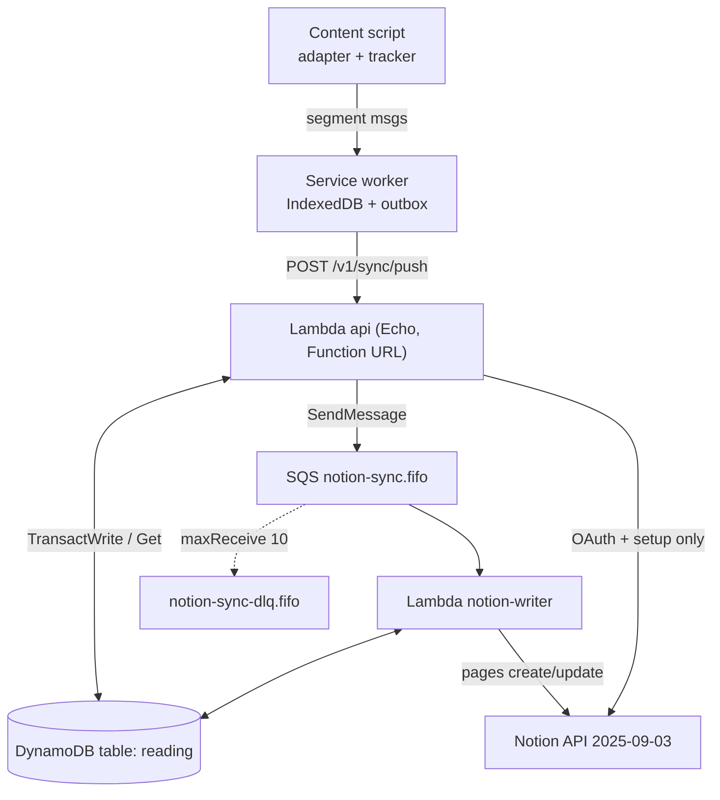

# Reading Tracker — Agent Spec

> **Context:** Chrome MV3 extension measures active reading time per article (Freedium/Medium first, any domain via a generic adapter), stores locally, and pushes batches to a Go backend on AWS Lambda (Echo via Function URL). The backend stores aggregates in DynamoDB and, through an SQS FIFO queue, writes one page per article (+ one page per day) into the user's Notion workspace, connected via a **public Notion OAuth integration**. Sync is **one-way** (extension → backend → Notion). Target running cost: **$0** (AWS Always Free).
> **Rationale & mental model:** [`reading-tracker-onboarding.md`](./reading-tracker-onboarding.md).
> **Status:** Chosen, not built. **Items in §7 are NOT decided — do not hardcode them.**

---

## 1. System at a glance



**Key decisions (rationale in onboarding §1.3):**
- Library store → **Notion** (not Postgres/SQLite). (onboarding D1)
- Sync → **one-way**, no webhooks. (D2)
- Compute → **AWS Lambda, Go, `provided.al2023`, arm64**, Echo via `aws-lambda-go-api-proxy` (payload v2). (D3)
- Entry → **Lambda Function URL**, no API Gateway. (D4)
- Server DB → **DynamoDB single table, PROVISIONED 25 RCU / 25 WCU, no GSIs**. (D5)
- Notion rate limit + debounce → **SQS FIFO, `MessageGroupId = installation_id`, bucketed dedup IDs, queue delivery delay**. (D6, onboarding §4.3)
- Token encryption → **AES-256-GCM in app**, keys from **SSM Parameter Store → Lambda env via Terraform**. No KMS CMK. (D7)
- IaC → **Terraform owns all resources**; **SAM CLI only for build/local invoke** (`--hook-name terraform`). No SAM template. (D8)
- Notion → **public integration, OAuth 2.0, template duplication**; pinned `Notion-Version: 2025-09-03`. (D9)
- Notion properties are **server-owned XOR user-owned**; server never writes user-owned ones. (onboarding §4.2)
- One **active installation per user** in v1.

---

## 2. Interface / API contracts

### 2.0 Conventions

- Base URL: `${API_BASE}` (🔶 §7). All bodies JSON, UTF-8. Times RFC 3339 UTC.
- Auth (all endpoints except 2.1, 2.2, 2.3, 2.10): `Authorization: Bearer rt_<43 chars base64url>`.
- Error body (all non-2xx JSON responses):
```json
{ "error": { "code": "invalid_request", "message": "segments[3].active_seconds out of range" } }
```
| HTTP | `code` | When |
|---|---|---|
| 400 | `invalid_request` | validation failed |
| 400 | `invalid_grant` | bad/expired auth code or PKCE mismatch |
| 401 | `unauthorized` | missing/unknown/revoked device token |
| 404 | `not_found` | |
| 409 | `conflict` / `no_installation` | state conflict / user has no installation |
| 413 | `payload_too_large` | body > 256 KB or list limits exceeded |
| 503 | `capacity_exceeded` | DynamoDB throttled the whole request; client retries with backoff |
| 500 | `internal` | |

### 2.1 `GET /v1/oauth/notion/start`

Query: `ext_redirect=https://<ext-id>.chromiumapp.org/` · `code_challenge=<base64url(SHA-256(verifier))>` · `code_challenge_method=S256`

**Handler does**
1. Reject (400) unless `ext_redirect` host is `<id>.chromiumapp.org` with `<id>` ∈ `ALLOWED_EXTENSION_IDS`.
2. `state` = 32 random bytes, base64url. Put `OAUTHSTATE#<state>` (§3) with TTL 600 s.
3. `302 Location: https://api.notion.com/v1/oauth/authorize?client_id=<NOTION_CLIENT_ID>&response_type=code&owner=user&redirect_uri=<urlenc(REDIRECT_URI)>&state=<state>`
   - `REDIRECT_URI` = `${PUBLIC_BASE_URL}/v1/oauth/notion/callback`; if `PUBLIC_BASE_URL` empty, derive from request `Host` (see C14).

### 2.2 `GET /v1/oauth/notion/callback`

Query: `code`, `state` — or `error=access_denied&state`.

**Handler does**
1. Conditional-delete `OAUTHSTATE#<state>` (must exist, not expired). Missing → 400 HTML/text "Link expired, try again".
2. If `error` → `302 <ext_redirect>?error=<error>`.
3. `POST https://api.notion.com/v1/oauth/token`, header `Authorization: Basic base64(client_id:client_secret)`, `Notion-Version`, body:
```json
{ "grant_type": "authorization_code", "code": "<code>", "redirect_uri": "<REDIRECT_URI>" }
```
   Expected response fields used: `access_token`, `refresh_token`, `bot_id`, `workspace_id`, `workspace_name`, `workspace_icon`, `owner.user.id`, `owner.user.name`, `owner.user.person.email` (may be absent), `duplicated_template_id` (nullable), `expires_in` (if present).
4. Resolve user: `GetItem NUSER#<owner.user.id>` → `user_id`, else create ULID `user_id`, put `USER#…/PROFILE` + `NUSER#…/USER`.
5. Upsert `INST#<bot_id>/META` with tokens encrypted (AAD = `bot_id`), `status`, workspace fields; put `USER#<uid>/INST#<bot_id>` pointer; set `PROFILE.active_installation_id = bot_id`.
6. If `duplicated_template_id` → run **template resolution** (§2.11). Success → `status=active`; failure → `status=needs_setup`, `setup_error=<reason>`. No template → `needs_setup`.
7. If status became `active` → run **resync enqueue** (T22).
8. `code` = 32 random bytes base64url. Put `AUTHCODE#<code>` TTL 120 s with `{user_id, installation_id, code_challenge, ext_redirect}`.
9. `302 <ext_redirect>?code=<code>`.

### 2.3 `POST /v1/auth/token`

**Request**
```json
{ "code": "Jx3…", "code_verifier": "dBjftJeZ4CVP-mB92K27uhbUJU1p1r_wW1gFWFOEjXk", "device_name": "MacBook Chrome" }
```
**Handler does**
1. Conditional-delete `AUTHCODE#<code>`; missing → 400 `invalid_grant`.
2. `base64url(SHA-256(code_verifier)) == code_challenge` (constant-time) else 400 `invalid_grant`.
3. `device_id` = ULID; `token` = `"rt_" + base64url(32 random bytes)`; `hmac = hex(HMAC-SHA256(DEVICE_TOKEN_PEPPER, token))`.
4. Put `USER#<uid>/DEVICE#<device_id>` and `DEVTOKEN#<hmac>/DEVTOKEN`.

**Response** `200`
```json
{
  "device_token": "rt_q8V1…",
  "device_id": "01J9ZK6S8Y3W2E7Q4R5T6U7V8W",
  "user": { "id": "01J9ZK5…", "name": "Tuan Do" },
  "installation": {
    "id": "b7c1e0f2-…",
    "workspace_name": "Tuan's Notion",
    "status": "active",
    "library_url": "https://www.notion.so/2a1b…"
  }
}
```

### 2.4 Auth middleware (all authenticated routes)
1. Parse `Bearer rt_…`; compute hmac; `GetItem DEVTOKEN#<hmac>` → `{user_id, device_id}`; absent or device `revoked_at` set → 401.
2. Load `PROFILE` (→ `active_installation_id`). Put both in Echo context.
3. Update `DEVICE.last_seen_at` **at most once per hour** (conditional on `last_seen_at < now-1h`) — WCU budget.

### 2.5 `GET /v1/me` → `200`
```json
{
  "user": { "id": "01J9ZK5…", "name": "Tuan Do" },
  "device": { "id": "01J9ZK6…", "name": "MacBook Chrome" },
  "installation": { "id": "b7c1…", "workspace_name": "Tuan's Notion", "status": "needs_setup", "setup_error": "template_not_found", "library_url": null }
}
```
`installation` is `null` if none.

### 2.6 `GET /v1/setup/pages?q=<text>` → `200`
Calls Notion `POST /v1/search` `{ "query": q, "filter": {"property":"object","value":"page"}, "page_size": 25 }`.
```json
{ "pages": [ { "id": "1f2e…", "title": "Reading", "url": "https://www.notion.so/1f2e…" } ] }
```

### 2.7 `POST /v1/setup`
**Request** `{ "parent_page_id": "1f2e…" }`
**Handler does:** 409 if installation `active`. Create **Reading Library** then **Daily Log** under the parent (schemas §3.3) via `POST /v1/databases`; resolve data source + property IDs; save; `status=active`; resync enqueue.
**Response** `200` → same shape as `installation` in 2.5.

### 2.8 `POST /v1/sync/push`

**Request**
```json
{
  "client_time": "2026-10-06T03:12:00Z",
  "tz": "Asia/Ho_Chi_Minh",
  "articles": [
    {
      "canonical_url": "https://medium.com/p/8f3c2a1b9d4e",
      "source": "medium",
      "title": "Designing Idempotent APIs",
      "author": "Jane Doe",
      "site_name": "Better Programming",
      "word_count": 1820,
      "published_at": "2026-09-30",
      "original_url": "https://freedium-mirror.cfd/https://medium.com/better-programming/designing-idempotent-apis-8f3c2a1b9d4e"
    }
  ],
  "segments": [
    {
      "id": "6f1d2c9e-6a43-4b1e-9a0e-2f7c1d5b8e11",
      "session_id": "c3a9…",
      "seq": 0,
      "canonical_url": "https://medium.com/p/8f3c2a1b9d4e",
      "started_at": "2026-10-06T03:01:05Z",
      "ended_at": "2026-10-06T03:02:10Z",
      "active_seconds": 58,
      "max_progress": 0.42
    }
  ]
}
```

**Validation** (per item; invalid items go to `rejected`, request still 200 unless the envelope is invalid):
- Envelope: body ≤ 256 KB, `articles` ≤ 50, `segments` ≤ 50, `tz` loads via `time.LoadLocation` (else 400).
- `canonical_url`: absolute `https`/`http`, ≤ 2048 chars. `source` ∈ `[a-z0-9_-]{1,32}`. Strings trimmed; `title` ≤ 500, `author`/`site_name` ≤ 200 chars. `word_count` 0…200000.
- Segment: `id` UUID; `seq` ≥ 0; `1 ≤ active_seconds ≤ 3600`; `ended_at ≥ started_at`; `active_seconds ≤ (ended_at − started_at) + 5`; `0 ≤ max_progress ≤ 1`; `started_at` within [now − 30 d, now + 5 min]; `canonical_url` present in this request's `articles[]`.

**Handler does** (installation = `PROFILE.active_installation_id`; none → 409 `no_installation`):
1. `url_hash = hex(SHA-256(canonical_url))[:32]`; `date = started_at` in `tz`, `YYYY-MM-DD`.
2. Per valid segment, **one** `TransactWriteItems` (§3.2 "push transaction").
   - `TransactionCanceledException` with `ConditionalCheckFailed` on the SEG put → `duplicate`.
   - Throttling (`ProvisionedThroughputExceeded`/`ThrottlingException`) → `retry`.
3. After a committed transaction, two conditional updates on ART (ignore `ConditionalCheckFailed`): `max_progress` and `last_read_at` (§3.2).
4. For each distinct `(url_hash)` and `(date)` touched by ≥1 accepted segment: `SendMessage` (§2.12).
5. If every segment was throttled → 503 `capacity_exceeded`.

**Response** `200`
```json
{
  "accepted": ["6f1d2c9e-…"],
  "duplicate": [],
  "retry": [],
  "rejected": [ { "id": "aa11…", "reason": "active_seconds_out_of_range" } ]
}
```
Client marks `accepted ∪ duplicate` as synced; keeps `retry`; drops `rejected` (log locally).

### 2.9 `POST /v1/articles/status`
**Request** `{ "canonical_urls": ["https://medium.com/p/8f3c2a1b9d4e"] }` (≤ 100)
**Handler:** `BatchGetItem` `INST#<inst>/ART#<hash>` (retry `UnprocessedKeys`).
**Response** `200` (unknown URLs omitted)
```json
{
  "items": {
    "https://medium.com/p/8f3c2a1b9d4e": {
      "total_seconds": 734, "max_progress": 0.97, "sessions": 2, "completed": true,
      "last_read_at": "2026-10-06T03:20:00Z", "notion_url": "https://www.notion.so/9a8b…"
    }
  }
}
```

### 2.10 `GET /v1/config` (no auth) → `200`
```json
{
  "version": 1,
  "tracking": {
    "idle_seconds": 60, "segment_seconds": 60, "min_create_seconds": 30,
    "complete_progress": 0.9, "complete_time_ratio": 0.3, "words_per_minute": 230,
    "sync_interval_minutes": 2, "sync_threshold_segments": 20
  },
  "freedium_hosts": ["freedium-mirror.cfd", "freedium.cfd"],
  "strip_query_params": ["utm_*", "fbclid", "gclid", "mc_cid", "mc_eid", "ref", "source"]
}
```
Values come from embedded defaults, overridable by env `TRACKING_CONFIG_JSON`. All values 🔶 §7. Response header `Cache-Control: max-age=3600`.

### 2.11 Template resolution (internal, used by 2.2 and 2.7)
1. `GET /v1/blocks/{duplicated_template_id}/children` (paginate `start_cursor`) → blocks with `type=child_database`; match `child_database.title` exactly `"Reading Library"` and `"Daily Log"`.
2. For each: `GET /v1/databases/{id}` → `data_sources[0].id`; `GET /v1/data_sources/{ds_id}` → `properties` map.
3. Validate every property in §3.3 exists **by name with expected type**; store `props[logical_key] = property.id`.
4. Failure reasons (stored in `setup_error`): `template_not_found`, `database_missing:<name>`, `property_missing:<name>`, `property_type:<name>`.

### 2.12 Queue messages (`notion-sync.fifo`)

| type | Body | `MessageGroupId` | `MessageDeduplicationId` |
|---|---|---|---|
| article | `{"type":"article","installation_id":"<bot_id>","url_hash":"<hash>"}` | `<bot_id>` | `article#<bot_id>#<hash>#<floor(unix/B)>` |
| day | `{"type":"day","installation_id":"<bot_id>","date":"2026-10-06"}` | `<bot_id>` | `day#<bot_id>#<date>#<floor(unix/B)>` |
| purge | `{"type":"purge","user_id":"<uid>","installation_id":"<bot_id or empty>"}` | `<bot_id>` or `user#<uid>` | `purge#<uid>#<unix>` |

`B` = `DEBOUNCE_BUCKET_SECONDS`. Queue `delay_seconds` = `D`. **Require `D ≥ B` and `B ≤ 300`** (C5). Dedup IDs ≤ 128 chars (hash is 32 hex → fits).

### 2.13 Worker — `article` message
1. `GetItem INST#<id>/META`. `status != active` → **ack** (data stays in DDB; resync on reactivation).
2. `GetItem ART`. Compute `completed` (sticky: once true stays true):
   `est = word_count / words_per_minute * 60`; `completed = stored.completed || (max_progress ≥ complete_progress && (word_count == 0 || total_seconds ≥ complete_time_ratio * est))`.
3. If no `notion_page_id`:
   - `total_seconds < min_create_seconds` → ack.
   - `POST /v1/data_sources/{library_ds_id}/query` with `{"filter":{"property":"<props.url>","url":{"equals":"<canonical_url>"}},"page_size":1}`; found → adopt its id/url.
   - else `POST /v1/pages` with `parent: {"type":"data_source_id","data_source_id":"<library_ds_id>"}`, **creation properties + server-owned metric properties** (§3.3), `children`: one `bookmark` block `{ "url": "<canonical_url>" }`.
   - Save `notion_page_id`, `notion_url`.
4. Else `PATCH /v1/pages/{id}` with **server-owned metric properties only**.
5. `UpdateItem ART SET notion_synced_version=:v, notion_synced_at=:now, completed=:c` (condition: not exists or `< :v`).

### 2.14 Worker — `day` message
1. Installation active check (as 2.13.1). `GetItem DAY`.
2. `BatchGetItem` ART for `article_hashes` → collect `notion_page_id`s (skip missing; cap 100).
3. No `notion_page_id`: query Daily Log by `Date` equals `date` → adopt, else create (`Name`=date, `Date`=date, `Minutes`, `Articles`).
4. Else PATCH `Minutes = round(seconds/60)`, `Articles` = page ids.
5. Save page id + synced version.

### 2.15 Worker — error handling (all Notion calls)
| Notion response | Action |
|---|---|
| 429 / 529 | `ChangeMessageVisibility(Retry-After + rand(0..3) s)`; report this and all later messages of the batch as failed |
| 5xx, network | report failed (normal visibility timeout) |
| 401 | refresh once (§2.16); retry call; refresh `invalid_grant` → `status=revoked`, ack |
| 404 / `archived` page | clear `notion_page_id`/`notion_url` on ART (or DAY); re-enqueue same message type; ack |
| 404 / `object_not_found` on data source | `status=needs_setup`, `setup_error=database_missing:<name>`; ack |
| 400 `validation_error` | log body, ack (poison message) |

Pacing: ≥ 350 ms between Notion calls within one invocation.

### 2.16 Token refresh (worker only)
`POST /v1/oauth/token` Basic auth, body `{"grant_type":"refresh_token","refresh_token":"<rt>"}` → persist **new** `access_token` **and** `refresh_token` with `UpdateItem … ConditionExpression token_version = :old SET token_version = :old + 1`.

### 2.17 Other endpoints
- `POST /v1/auth/logout` → set `DEVICE.revoked_at`, delete `DEVTOKEN#<hmac>` → `204`.
- `DELETE /v1/me` → revoke all devices of user (delete DEVTOKEN items), set `PROFILE.deleted_at`, enqueue `purge` → `202`. Worker purge: Query+`BatchWriteItem` delete all `INST#<bot_id>/*`, `USER#<uid>/*`, `NUSER#…`. **Never deletes Notion content.**

---

## 3. Data model

### 3.1 DynamoDB table `reading-<env>`
- Keys: `pk` (S), `sk` (S). **No GSIs.** Billing **PROVISIONED** 25 RCU / 25 WCU, autoscaling **off**, PITR **off**. TTL attribute: `ttl` (epoch seconds).

| pk | sk | Attributes |
|---|---|---|
| `USER#<uid>` | `PROFILE` | `notion_user_id`, `name`, `email?`, `active_installation_id?`, `created_at`, `deleted_at?` |
| `NUSER#<notion_user_id>` | `USER` | `user_id` |
| `USER#<uid>` | `INST#<bot_id>` | `created_at` (pointer for purge/listing) |
| `USER#<uid>` | `DEVICE#<device_id>` | `name`, `token_hmac`, `created_at`, `last_seen_at`, `revoked_at?` |
| `DEVTOKEN#<hmac>` | `DEVTOKEN` | `user_id`, `device_id` |
| `INST#<bot_id>` | `META` | `user_id`, `workspace_id`, `workspace_name`, `status` (`active`\|`needs_setup`\|`revoked`), `setup_error?`, `access_token_enc`, `refresh_token_enc`, `token_expires_at?`, `token_version` (N), `duplicated_template_id?`, `library_db_id`, `library_ds_id`, `library_url`, `daily_db_id`, `daily_ds_id`, `props` (M: logical_key → property id), `created_at`, `updated_at` |
| `INST#<bot_id>` | `ART#<url_hash>` | `canonical_url`, `source`, `title`, `author`, `site_name`, `word_count`, `published_at`, `first_read_at`, `last_read_at`, `total_seconds` (N), `sessions` (N), `max_progress` (N), `completed` (BOOL), `version` (N), `notion_page_id?`, `notion_url?`, `notion_synced_version?`, `notion_synced_at?` |
| `INST#<bot_id>` | `SEG#<segment_id>` | `session_id`, `seq`, `url_hash`, `device_id`, `started_at`, `ended_at`, `active_seconds`, `max_progress`, `ttl` = started_at + 90 d |
| `INST#<bot_id>` | `DAY#<YYYY-MM-DD>` | `date`, `seconds` (N), `article_hashes` (SS), `version` (N), `notion_page_id?`, `notion_synced_version?` |
| `OAUTHSTATE#<state>` | `STATE` | `ext_redirect`, `code_challenge`, `ttl` = now + 600 |
| `AUTHCODE#<code>` | `CODE` | `user_id`, `installation_id`, `code_challenge`, `ext_redirect`, `ttl` = now + 120 |

**TTL caveat:** DynamoDB deletes expired items lazily (up to days). Every read of `OAUTHSTATE`/`AUTHCODE` **must also check `ttl > now`**.

### 3.2 Write expressions

**Push transaction** (one per segment):
```
Put    pk=INST#i, sk=SEG#<id>, …            Condition: attribute_not_exists(pk)
Update pk=INST#i, sk=ART#<h>
       SET canonical_url = if_not_exists(canonical_url, :u), source = if_not_exists(source, :src),
           title = if_not_exists(title, :t), author = if_not_exists(author, :a),
           site_name = if_not_exists(site_name, :sn), word_count = if_not_exists(word_count, :wc),
           published_at = if_not_exists(published_at, :pa), first_read_at = if_not_exists(first_read_at, :st)
       ADD total_seconds :as, sessions :isFirst, version :one          (:isFirst = 1 if seq == 0 else 0)
Update pk=INST#i, sk=DAY#<date>
       SET #d = :date  ADD seconds :as, version :one, article_hashes :hset
```
**After commit** (separate, ignore ConditionalCheckFailed):
```
UpdateItem ART SET max_progress = :p   Condition: attribute_not_exists(max_progress) OR max_progress < :p
UpdateItem ART SET last_read_at = :e   Condition: attribute_not_exists(last_read_at) OR last_read_at < :e
```
Skip an update whose value cannot win (e.g. `:p == 0`).

### 3.3 Notion schema (template + `POST /v1/setup`)

**Reading Library** (data source):

| Logical key | Property name | Type | Owner | Written |
|---|---|---|---|---|
| `title` | `Name` | title | server | create |
| `url` | `URL` | url | server | create |
| `source` | `Source` | select | server | create |
| `author` | `Author` | rich_text | server | create |
| `site` | `Site` | select | server | create |
| `word_count` | `Word count` | number | server | create |
| `first_read` | `First read` | date | server | create |
| `last_read` | `Last read` | date | server | create + update |
| `minutes` | `Reading time (min)` | number | server | create + update (`round(total_seconds/60)`) |
| `progress` | `Progress` | number (format `percent`, value 0–1) | server | create + update |
| `sessions` | `Sessions` | number | server | create + update |
| `completed` | `Completed` | checkbox | server | create + update |
| — | `Tags` | multi_select | **user** | **never** |
| — | `Status` | status (`Not started`, `Reading`, `Done`, `Abandoned`, `Read later`) | **user** | **never** |
| — | `Rating` | select (`⭐`…`⭐⭐⭐⭐⭐`) | **user** | **never** |
| — | `Notes` | rich_text | **user** | **never** |

**Daily Log** (data source):

| Logical key | Property name | Type | Owner |
|---|---|---|---|
| `day_title` | `Name` | title (`YYYY-MM-DD`) | server |
| `day_date` | `Date` | date | server |
| `day_minutes` | `Minutes` | number | server |
| `day_articles` | `Articles` | relation → Reading Library data source | server |

Writes address properties **by stored property ID** (`props[...]`), not by name (C9). Select values for `Source`/`Site` are written by name (Notion creates missing options).

### 3.4 Extension local storage (IndexedDB via Dexie)
```ts
articles: { canonical_url (PK), source, title, author, site_name, word_count, published_at, original_url,
            total_seconds, max_progress, last_read_at }
segments: { id (PK), session_id, seq, canonical_url, started_at, ended_at, active_seconds, max_progress,
            synced: 0 | 1, created_at }          // index: synced, started_at
kv:       { key (PK), value }                    // device_token, device_id, installation, config cache,
                                                 // enabled_domains, denied_domains, sync_backoff_until
```
Synced segments older than 30 days are deleted locally.

### 3.5 Environment variables

| Var | Source | Used by |
|---|---|---|
| `APP_ENV` | tf var | both |
| `TABLE_NAME` | tf | both |
| `QUEUE_URL` | tf | api, worker (re-enqueue) |
| `NOTION_CLIENT_ID` | SSM `/reading/<env>/NOTION_CLIENT_ID` | both |
| `NOTION_CLIENT_SECRET` | SSM SecureString | both |
| `NOTION_VERSION` | tf, `2025-09-03` | both |
| `TOKEN_ENC_KEYS` | SSM SecureString, `"v1:<b64 32B>[,v0:<b64 32B>…]"` — first = current | both |
| `DEVICE_TOKEN_PEPPER` | SSM SecureString, ≥ 32 random bytes b64 | api |
| `ALLOWED_EXTENSION_IDS` | tf var, comma-separated | api |
| `PUBLIC_BASE_URL` | tf var, may be empty (C14) | api |
| `DEBOUNCE_BUCKET_SECONDS` | tf var | api |
| `TRACKING_CONFIG_JSON` | tf var, optional | api, worker |
| `STORE` | k8s ConfigMap/Secret, `dynamo` (default) or `postgres` | k8s/postgres: server/poller |
| `DATABASE_URL` | k8s ConfigMap/Secret | k8s/postgres: server/poller |
| `QUEUE_DELAY_SECONDS` | k8s ConfigMap/Secret, default = `DEBOUNCE_BUCKET_SECONDS`; `D ≥ B`, `≤ 900` | k8s/postgres: server/poller |
| `LISTEN_ADDR` | k8s ConfigMap/Secret, default `:8080` | k8s/postgres: server |
| `HEALTH_ADDR` | k8s ConfigMap/Secret, default `:8081` | k8s/postgres: poller |
| `POLL_INTERVAL_SECONDS` | k8s ConfigMap/Secret, default `1` | k8s/postgres: poller |

§3.1–§3.2 describe the DynamoDB mapping; the Postgres mapping is design
`docs/superpowers/specs/2026-10-25-postgres-k8s-design.md` §6 plus migration
`backend/internal/platform/pgmigrate/migrations/0001_store.sql`.

---

## 4. Implementation plan

### 4.1 Suggested structure
```
reading-chrome-extension/
├── docs/                         # these specs
├── extension/
│   ├── manifest.config.ts        # MV3 manifest (crxjs or vite-plugin-web-extension)
│   ├── src/
│   │   ├── adapters/             # types.ts, freedium-medium.ts, generic.ts, registry.ts
│   │   ├── lib/                  # normalize-url.ts, uuid.ts, api.ts, pkce.ts
│   │   ├── content/              # tracker.ts, index.ts
│   │   ├── background/           # db.ts (Dexie), sync.ts, auth.ts, messages.ts, index.ts
│   │   ├── popup/
│   │   └── options/
│   └── test/
├── backend/
│   ├── cmd/api/main.go           # lambda.Start(echoadapter.NewV2(e).ProxyWithContextV2)
│   ├── cmd/worker/main.go        # lambda.Start(handleSQS)
│   ├── cmd/local/main.go         # e.Start(":8080") + in-process queue + DynamoDB Local
│   ├── internal/config/
│   ├── internal/crypto/          # keyring (AES-GCM), token hmac, pkce
│   ├── internal/store/           # dynamo keys, repos, transactions
│   ├── internal/notion/          # thin client + typed errors
│   ├── internal/httpapi/         # echo app, middleware, handlers
│   ├── internal/syncsvc/         # push validation + aggregation
│   ├── internal/queue/           # sender + dedup ids
│   ├── internal/worker/          # article, day, purge handlers
│   ├── events/                   # sample SQS events for sam local invoke
│   └── Makefile                  # build-api, build-worker → bootstrap (linux/arm64)
└── infra/terraform/
    ├── backend.tf providers.tf variables.tf outputs.tf
    ├── ssm.tf dynamodb.tf sqs.tf lambda.tf iam.tf logs.tf budget.tf
    └── sam-metadata.tf           # null_resource sam_metadata_* for SAM CLI hook
```

### 4.2 Tasks

**Infrastructure (Terraform)**
- [ ] **T1 — State + providers.** S3 backend with `encrypt = true`, `use_lockfile = true`; bucket has public access block + SSE-S3; AWS provider with region var.
  - *AC:* `terraform init` succeeds against the bucket; the bucket denies public access; no DynamoDB lock table exists.
- [ ] **T2 — Secrets.** Document (README) manual creation of the 4 SSM params as **Standard** tier (`String` for client id, `SecureString` with default `aws/ssm` key for the others). `data "aws_ssm_parameter"` reads them; values flow into Lambda env.
  - *AC:* `terraform plan` shows env vars sourced from SSM data; no secret literal in `.tf`/`.tfvars`; parameter tier = Standard.
- [ ] **T3 — DynamoDB.** Table per §3.1.
  - *AC:* `aws dynamodb describe-table` → `PROVISIONED`, 25/25, TTL enabled on `ttl`, 0 GSIs, PITR disabled.
- [ ] **T4 — SQS.** `notion-sync-<env>.fifo` (`fifo_queue`, `content_based_deduplication=false`, `delay_seconds=var.debounce_delay_seconds`, `visibility_timeout_seconds=360`) + DLQ `.fifo` (retention 14 d), redrive `maxReceiveCount=10`. Terraform `validation`/`precondition`: `delay ≥ bucket` and `bucket ≤ 300`.
  - *AC:* plan fails when `debounce_delay_seconds < debounce_bucket_seconds`; queue attributes match.
- [ ] **T5 — Lambdas.** Build via `terraform_data`/`null_resource` running `make` → `bootstrap` (`GOOS=linux GOARCH=arm64 CGO_ENABLED=0 -tags lambda.norpc`), `archive_file`. `api`: 128 MB, 10 s, Function URL `authorization_type=NONE`, CORS `allow_origins = chrome-extension://<id>` per allowed id, headers `authorization,content-type`. `worker`: 128 MB, 60 s, event source mapping (batch 10, `ReportBatchItemFailures`, `scaling_config.maximum_concurrency=2`). Log groups created explicitly with 7-day retention. Least-privilege IAM (api: DDB Get/Put/Update/Delete/Query/BatchGet/TransactWrite + SQS SendMessage; worker: same + BatchWrite + SQS Receive/Delete/ChangeMessageVisibility/GetQueueAttributes/SendMessage).
  - *AC:* `curl ${function_url}/v1/config` → 200 JSON; log groups show retention 7; IAM policies reference only this table/queue ARNs.
- [ ] **T6 — Budget.** `aws_budgets_budget` monthly COST $1, alert at 80 % actual to `var.budget_email`.
  - *AC:* budget visible in console with the email subscriber.
- [ ] **T7 — SAM CLI hook.** `sam-metadata.tf` with `null_resource "sam_metadata_aws_lambda_function_<name>"` for both functions; `backend/events/sqs-article.json`.
  - *AC:* `sam build --hook-name terraform` succeeds; `sam local invoke --hook-name terraform 'aws_lambda_function.worker' -e backend/events/sqs-article.json` runs the handler.

**Backend (Go)**
- [ ] **T8 — Config.** Parse/validate env (§3.5); fail fast on missing; parse `TOKEN_ENC_KEYS`; embed default tracking config; `import _ "time/tzdata"`.
  - *AC:* unit test: missing `TABLE_NAME` → error; `time.LoadLocation("Asia/Ho_Chi_Minh")` works in a `scratch`/al2023 container.
- [ ] **T9 — Crypto.** Keyring `Seal(plain, aad) → "<ver>:<b64(nonce‖ct)>"`, `Open`; token HMAC; PKCE S256 verify (constant-time).
  - *AC:* round-trip test; `Open` with different AAD fails; ciphertext from `v0` opens after `v1` is prepended; tampered byte fails.
- [ ] **T10 — Store.** Key builders, typed repos for every item in §3.1, push transaction + post-commit updates (§3.2), throttle-error classification.
  - *AC:* integration test on DynamoDB Local: pushing same segment twice → aggregates incremented once; `max_progress` never decreases.
- [ ] **T11 — Notion client.** Endpoints: oauth token (code + refresh), search, blocks children (paginated), databases get/create, data_sources get/query, pages create/update. Sets `Notion-Version`. Typed error `{Status, Code, RetryAfter}`.
  - *AC:* `httptest` server tests: 429 with `Retry-After: 2` → error with `RetryAfter=2s`; header `Notion-Version: 2025-09-03` present on every request.
- [ ] **T12 — Echo app.** Router `/v1`, error format §2.0, request body limit 256 KB, auth middleware §2.4, request logging (no tokens/bodies), `cmd/api` (Lambda) and `cmd/local`.
  - *AC:* `go run ./cmd/local` serves `/v1/config`; unauthenticated `GET /v1/me` → 401 JSON error shape.
- [ ] **T13 — OAuth start + callback** (§2.1, §2.2).
  - *AC:* unknown extension id → 400; reused `state` → 400; happy path (Notion mocked) → 302 to `https://<id>.chromiumapp.org/?code=…` and INST stored with encrypted tokens (no plaintext token in item).
- [ ] **T14 — `POST /v1/auth/token`** (§2.3).
  - *AC:* wrong verifier → 400 `invalid_grant`; code usable once; token stored only as HMAC.
- [ ] **T15 — Template resolution + setup endpoints** (§2.6, §2.7, §2.11).
  - *AC:* template missing `Progress` → `needs_setup` with `setup_error=property_missing:Progress`; `POST /v1/setup` creates both DBs (mocked) and flips to `active`.
- [ ] **T16 — `POST /v1/sync/push`** (§2.8).
  - *AC:* response classifies accepted/duplicate/retry/rejected correctly in tests; one article + one day message sent per distinct key; `date` computed in request `tz` (segment at `2026-10-05T18:30Z` with `Asia/Ho_Chi_Minh` → `2026-10-06`).
- [ ] **T17 — `GET /v1/me`, `POST /v1/articles/status`, `GET /v1/config`, `POST /v1/auth/logout`.**
  - *AC:* logout then any call with same token → 401; status for 100 URLs uses ≤ 1 BatchGet round trip + unprocessed retries.
- [ ] **T18 — Queue sender.** Dedup ID builder per §2.12.
  - *AC:* two sends for same article within one bucket produce identical dedup IDs; different buckets differ.
- [ ] **T19 — Worker: article** (§2.13).
  - *AC:* total below `min_create_seconds` → no Notion call; existing page found by URL query → adopted, not duplicated; PATCH body contains only server-owned metric property IDs.
- [ ] **T20 — Worker: day** (§2.14).
  - *AC:* Minutes = round(seconds/60); relation only includes articles with a page id.
- [ ] **T21 — Worker: errors + token refresh** (§2.15, §2.16). SQS partial batch response: on first failure, fail it and every later message in the batch.
  - *AC:* 429 → `ChangeMessageVisibility` called with ≥ Retry-After; refresh stores **both** new tokens and bumps `token_version`; `invalid_grant` → `revoked`; archived page → page id cleared + re-enqueued.
- [ ] **T22 — Resync on activation.** When installation becomes `active`, Query `INST#<id>` `begins_with(sk,"ART#")`, enqueue `article` for items with `version > notion_synced_version` (or never synced); same for `DAY#`.
  - *AC:* after needs_setup → active, all pending articles appear in Notion without new pushes.
- [ ] **T23 — Account deletion + purge** (§2.17).
  - *AC:* after `DELETE /v1/me` and worker run, Query on `USER#<uid>` and `INST#<bot_id>` return 0 items; Notion untouched.

**Notion**
- [ ] **T24 — Template page.** Public Notion page containing `Reading Library` and `Daily Log` exactly per §3.3, with views: "Reading now" (Status = Reading), "This week" (Last read within past week), "Completed", "Top rated" (Rating ≥ ⭐⭐⭐⭐), board by Status, gallery by Source; Daily Log bar chart of Minutes by Date. Configure its URL in the integration settings.
  - *AC:* OAuth with "duplicate template" yields `status=active` with no `setup_error`.

**Extension (MV3 + TypeScript + Vite)**
- [ ] **T25 — Scaffold.** Manifest: `permissions: ["storage","alarms","identity","scripting"]`, `host_permissions`: Freedium hosts, `https://medium.com/*`, `${API_BASE}/*`; `optional_host_permissions: ["https://*/*"]`; `"incognito": "not_allowed"`; `API_BASE` from `VITE_API_BASE`.
  - *AC:* `npm run build` produces a loadable unpacked extension; no `<all_urls>` in required permissions.
- [ ] **T26 — URL normalization + adapters.**
  - `normalizeUrl`: lowercase host, drop fragment, drop params matching `strip_query_params` (glob `utm_*`), drop trailing slash (except root), force `https` when the site serves https.
  - `freedium-medium` adapter: matches Freedium hosts (from config) and `medium.com`/`*.medium.com`. Canonical: if Freedium path starts with `/http`, the remainder is the original URL; extract Medium post id `/-?([0-9a-f]{10,16})$/` from the last path segment → `https://medium.com/p/<id>`; else fall back to `link[rel=canonical]` → `og:url` → normalized location. Metadata: title (`h1` / `og:title`), author, site/publication, word count from content root text. `original_url` = location.
  - `generic` adapter: only on user-enabled domains. Canonical: `link[rel=canonical]` → `og:url` → location, then normalize. Metadata: JSON-LD `Article`/`BlogPosting` (`headline`, `author.name`, `datePublished`, `wordCount`) → OpenGraph → `<meta name=author>`; content root `article` → `main` → `body`.
  - *AC:* unit tests: `https://freedium-mirror.cfd/https://medium.com/better-programming/designing-idempotent-apis-8f3c2a1b9d4e?source=x` → `https://medium.com/p/8f3c2a1b9d4e`; `https://medium.com/@jane/foo-8f3c2a1b9d4e` → same canonical; `https://example.com/post/?utm_source=x#h` → `https://example.com/post`.
- [ ] **T27 — Tracker** (state machine in onboarding §5.4). 1 s tick; activity events `scroll, wheel, mousemove (throttled 1 s), keydown, pointerdown, touchstart`; `visibilitychange`, `focus`, `blur`; idle after `idle_seconds`. Progress = clamp((scrollY + innerHeight − rootTop) / rootHeight, 0, 1), keep max. Flush a segment when segment active ≥ `segment_seconds`, on leaving Active (if ≥ 1 s), and on `pagehide`. New `session_id` per page load and per SPA URL change (watch `navigation` events / poll `location.href` 1 s); `seq` increments per session; ids via `crypto.randomUUID()`.
  - *AC:* fake-timer tests: hidden tab accrues 0 s; 2 min with no input accrues exactly `idle_seconds`; 150 s active with `segment_seconds=60` → segments of 60, 60, 30 on pagehide.
- [ ] **T28 — Service worker storage + sync.** Dexie schema §3.4; on segment message upsert article + put segment (`synced=0`); alarm `sync` every `sync_interval_minutes`, plus immediate sync when unsynced ≥ `sync_threshold_segments`; batches of ≤ 50 segments with their articles; handle response per §2.8; exponential backoff (1, 2, 4… max 30 min) on network/5xx/503; on 401 clear token → state "disconnected"; refresh `/v1/config` daily.
  - *AC:* offline for 1 h then online → all segments synced exactly once (server `accepted`+`duplicate` covers all ids); retried batch after a timeout produces only `duplicate` for previously committed ids.
- [ ] **T29 — Connect flow.** PKCE (verifier 64 chars), `chrome.identity.launchWebAuthFlow({url: API_BASE + '/v1/oauth/notion/start?…', interactive: true})`, parse `code`/`error` from redirect, `POST /v1/auth/token`, store token, `GET /v1/me`.
  - *AC:* user cancel / `error=access_denied` shows a message and stores nothing.
- [ ] **T30 — Popup.** States: disconnected → "Connect Notion"; `needs_setup` → "Finish setup" (opens options); `revoked` → "Reconnect"; active → today's active minutes (local segments with `started_at` today in local tz), current tab article (title, minutes, progress), last 5 articles, "Open library in Notion" (`library_url`).
  - *AC:* each installation status renders its own call-to-action; today's minutes equal sum of today's local segments / 60.
- [ ] **T31 — Options.** Enabled domains (request optional host permission, then `chrome.scripting.registerContentScripts`), denied domains, setup page picker (`GET /v1/setup/pages`, `POST /v1/setup`), disconnect (`/v1/auth/logout`), delete account (`DELETE /v1/me`, confirm dialog).
  - *AC:* enabling `example.com` starts tracking there without reinstall; removing it unregisters the script; denied domain is never tracked even if enabled.

**End to end**
- [ ] **T32 — Smoke test** in a dev AWS account + test Notion workspace.
  - *AC:* read a Freedium article 3 min → within `D + B + 60 s` a Library page exists with Reading time ≈ 3, Progress > 0; set Tags/Status/Rating in Notion, read again → those values unchanged, metrics updated; Daily Log row for today exists.

---

## 5. Test scenarios

1. **Happy path:** connect via template → read article → page created with correct properties; Daily Log updated.
2. **Retry double-submit:** same push body sent twice → second response all `duplicate`; `total_seconds` unchanged.
3. **Out-of-order segments:** seq 1 arrives before seq 0 → `sessions` incremented once (by seq 0), totals correct.
4. **Two devices, same article, same minute:** both pushes accepted; one Notion write per bucket; totals = sum.
5. **Below threshold:** 20 s read → no Notion page; later 15 s more → page created (35 s ≥ 30 s).
6. **Debounce boundary:** pushes at bucket start and bucket end − 1 s → one message; Notion reflects both (requires `D ≥ B`).
7. **User edits:** user sets Status `Abandoned`, Tags, Rating; then reads to 100 % → `Completed` ✓, Status still `Abandoned`, Tags/Rating untouched.
8. **User renames a property** (`Progress` → `Đã đọc %`) → writes still succeed (by property ID).
9. **User deletes the page** → next write gets 404/archived → page re-created once.
10. **User deletes the Library database** → installation `needs_setup`; pushes still accepted; after setup, resync creates all pages.
11. **Integration removed from workspace / refresh `invalid_grant`** → `revoked`; popup shows Reconnect; reconnect → resync.
12. **429 storm:** Notion returns 429 `Retry-After: 5` → message hidden ≥ 5 s; other installations' groups keep processing.
13. **Concurrent refresh impossible:** two messages of the same installation never run in parallel (FIFO group) — assert refresh happens once.
14. **DynamoDB throttling:** simulate `ProvisionedThroughputExceeded` → segments in `retry`; extension retries later; nothing double-counted.
15. **Validation:** `active_seconds = 4000`, `ended_at < started_at`, segment URL not in `articles[]`, `started_at` 40 days ago → each `rejected` with a reason.
16. **Timezone:** segment `2026-10-05T18:30:00Z`, `tz=Asia/Ho_Chi_Minh` → `DAY#2026-10-06`.
17. **OAuth abuse:** `ext_redirect` with foreign extension id → 400; replayed `state` → 400; replayed auth `code` → 400; wrong `code_verifier` → 400.
18. **Expired TTL item still present:** `AUTHCODE` with `ttl < now` but not yet deleted → rejected.
19. **Key rotation:** prepend `v2` key, redeploy → old installations still work; after a refresh, tokens re-encrypted with `v2`.
20. **Tab hidden / idle:** tracking pauses; returns resume; no segment with `active_seconds = 0` ever sent.
21. **Incognito:** extension does not run.
22. **Account deletion:** all DynamoDB items for the user gone after purge; Notion pages remain.
23. **Freedium mirror change:** new mirror host added via `TRACKING_CONFIG_JSON`/config → canonical URL identical to old mirror's → same ART item.

---

## 6. Constraints & gotchas

| # | Constraint | Consequence if violated |
|---|---|---|
| C1 | Server **never** writes `Tags`, `Status`, `Rating`, `Notes` — not even on create. | User's manual curation in Notion is silently overwritten. |
| C2 | Segment insert + aggregate increments in **one** transaction conditioned on `attribute_not_exists` of the SEG item. | Retries double-count reading time. |
| C3 | Only the worker calls Notion page/write APIs; API Lambda calls Notion only for OAuth/setup/search. | Parallel Lambdas exceed 3 req/s → 429s; push latency tied to Notion. |
| C4 | `MessageGroupId = installation_id` for every message. | Concurrent writes per connection → rate-limit violations and token-refresh races. |
| C5 | Queue `delay_seconds` **D ≥ B** (bucket) and **B ≤ 300**. | Last updates in a bucket are dropped until the next read (stale Notion data). |
| C6 | Worker writes **absolute** values read from DynamoDB, never deltas. | Redelivered messages corrupt totals. |
| C7 | On refresh, persist **both** new access and refresh tokens, guarded by `token_version`. | Notion rotates refresh tokens; keeping the old one → `invalid_grant` → user forced to reconnect. |
| C8 | Only the worker refreshes tokens. | Two refreshers invalidate each other. |
| C9 | Address Notion properties by stored **property ID**. | User renaming a column breaks sync. |
| C10 | Pin `Notion-Version: 2025-09-03`; use `/v1/data_sources/*` and `parent.type = data_source_id`. | Older/newer versions have different database semantics → 400s. |
| C11 | DynamoDB stays **PROVISIONED 25/25, no GSIs, no autoscaling, no PITR**. | Leaves Always Free → monthly bill. |
| C12 | Check `ttl > now` on every read of TTL'd items. | Expired OAuth state / auth codes still accepted (TTL deletion is lazy). |
| C13 | Never log tokens, auth codes, request bodies, or Notion responses containing tokens. | Credential leak via CloudWatch. |
| C14 | `NOTION_REDIRECT_URI` must not be a Terraform reference to the same function's URL (dependency cycle). Use `PUBLIC_BASE_URL` var or derive from request `Host`. The derived value must equal a redirect URI registered in Notion. | `terraform apply` cycle error, or Notion rejects the redirect. |
| C15 | `import _ "time/tzdata"` in Go binaries. | `time.LoadLocation` fails on `provided.al2023` → every push 400. |
| C16 | Build with `-tags lambda.norpc`, binary named `bootstrap`, `GOARCH=arm64`. | Lambda fails to start / bigger cold starts. |
| C17 | Secrets only via SSM → env; Terraform state bucket encrypted + private; IAM restricts `lambda:GetFunctionConfiguration`. | Plaintext secrets readable from state or console. |
| C18 | AES-GCM: fresh 12-byte random nonce per seal; AAD = `bot_id`. | Nonce reuse breaks confidentiality; without AAD, ciphertexts can be swapped between installations. |
| C19 | Extension holds **no** Notion credentials or client secret; only `rt_` device token. | Anyone unpacking the extension gets API access to all users. |
| C20 | Device tokens stored only as HMAC(pepper, token). | DB leak = account takeover. |
| C21 | FIFO + partial batch response: after the first failed message, report **it and all later messages** of the batch as failed. | Out-of-order processing within a group. |
| C22 | Worker paces Notion calls ≥ 350 ms and honours `Retry-After`. | Sustained 429s, possible integration throttling. |
| C23 | Extension never sends a segment with `active_seconds = 0`; flushes on `pagehide`, not `unload`. | Rejected segments / lost final seconds (unload unreliable in MV3 pages). |
| C24 | `"incognito": "not_allowed"`; generic adapter only on user-enabled domains. | Privacy breach; Chrome Web Store rejection. |
| C25 | Max 50 segments/push; one transaction per segment (3 items × 2 WCU). | Bursts beyond provisioned + burst capacity → throttling; oversized transactions fail. |
| C26 | Function URL public access requires a resource policy allowing unauthenticated invoke; auth is enforced in Echo middleware. | 403 on every request, or (if middleware skipped) open API. |
| C27 | `reserved_concurrency` may be unavailable on low-limit new accounts — use SQS `maximum_concurrency` for the worker. | `terraform apply` fails. |

---

## 7. Open questions — DO NOT HARDCODE

- 🔶 **`API_BASE` / `PUBLIC_BASE_URL`** — Function URL vs custom domain via CloudFront. Placeholder: `https://<function-url-id>.lambda-url.<region>.on.aws`. Keep configurable (Vite env, tf var).
- 🔶 **AWS region** — placeholder `ap-southeast-1`; tf variable.
- 🔶 **Extension ID(s)** — unknown until Chrome Web Store upload (dev unpacked IDs differ). Use `ALLOWED_EXTENSION_IDS` var; pin dev ID with a manifest `key`.
- 🔶 **Tracking thresholds** — `idle_seconds=60`, `segment_seconds=60`, `min_create_seconds=30`, `complete_progress=0.9`, `complete_time_ratio=0.3`, `words_per_minute=230`, `sync_interval_minutes=2`. Read from `/v1/config`; never inline constants in tracker/worker code.
- 🔶 **Debounce `B`/`D`** — placeholder `B = D = 120` s. Terraform vars.
- 🔶 **Freedium host list** — placeholder `["freedium-mirror.cfd","freedium.cfd"]`; config-driven.
- 🔶 **Stats dashboard** — none beyond popup + Notion views in v1. Don't build a `/v1/stats` endpoint yet.
- 🔶 **Multiple workspaces per user** — v1: one `active_installation_id`. Don't design APIs that assume many.
- 🔶 **Device token expiry** — v1 non-expiring + revocation.
- 🔶 **Notion access-token expiry** — handle reactively (401 → refresh); store `token_expires_at` if `expires_in` is returned but don't depend on it.
- 🔶 **Notion template public page URL and integration `client_id`** — not yet created (T24).
- 🔶 **Go module path / repo name** — placeholder `github.com/<owner>/reading-tracker/backend`.
- 🔶 **Exact Notion request bodies** for `POST /v1/databases` (initial data source properties, relation to a data source) — verify against the 2025-09-03 reference during T11/T15; shapes in this spec are indicative.

---

## 8. Appendix

**Stack**
| Layer | Choice |
|---|---|
| Extension | Chrome MV3, TypeScript, Vite (+ crxjs or vite-plugin-web-extension), Dexie, Vitest |
| Backend | Go ≥ 1.23, Echo v4, `aws-lambda-go`, `aws-lambda-go-api-proxy/echo` (V2), `aws-sdk-go-v2` (dynamodb, sqs), `oklog/ulid/v2` |
| Infra | Terraform ≥ 1.10 (S3 native locking), AWS provider, AWS SAM CLI (Terraform hook) |
| Local | `cmd/local`, DynamoDB Local (Docker), Notion mocked via `httptest` |

**External endpoints**
| Concern | Endpoint |
|---|---|
| Authorize | `GET https://api.notion.com/v1/oauth/authorize` |
| Token / refresh | `POST https://api.notion.com/v1/oauth/token` |
| Search pages | `POST /v1/search` |
| Template children | `GET /v1/blocks/{id}/children` |
| Database → data sources | `GET /v1/databases/{id}`, `POST /v1/databases` |
| Data source schema / query | `GET /v1/data_sources/{id}`, `POST /v1/data_sources/{id}/query` |
| Pages | `POST /v1/pages`, `PATCH /v1/pages/{id}` |

**Limits used**
| Limit | Value |
|---|---|
| Notion rate limit | avg 3 req/s per connection (+ per-workspace), 429 + `Retry-After` |
| SQS FIFO dedup window | 5 min |
| DynamoDB `TransactWriteItems` | ≤ 100 items, 2× WCU |
| DynamoDB `BatchGetItem` | ≤ 100 keys |
| AWS Always Free | Lambda 1M req/mo · DynamoDB 25 GB + 25 WCU/RCU · SQS 1M req/mo |

---
*Living document — update as 🔶 OPEN items resolve.*
