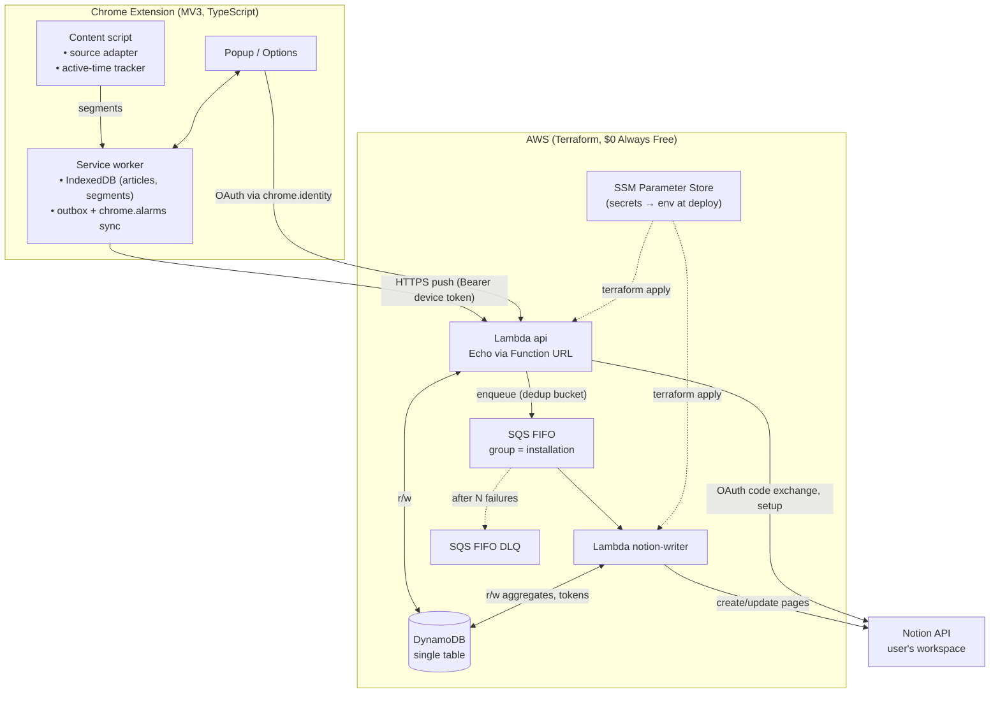
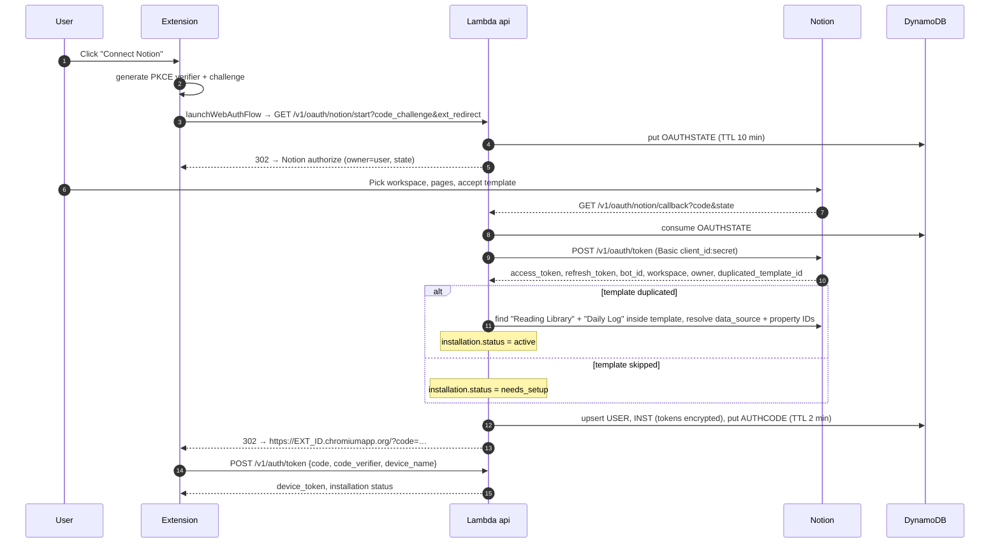
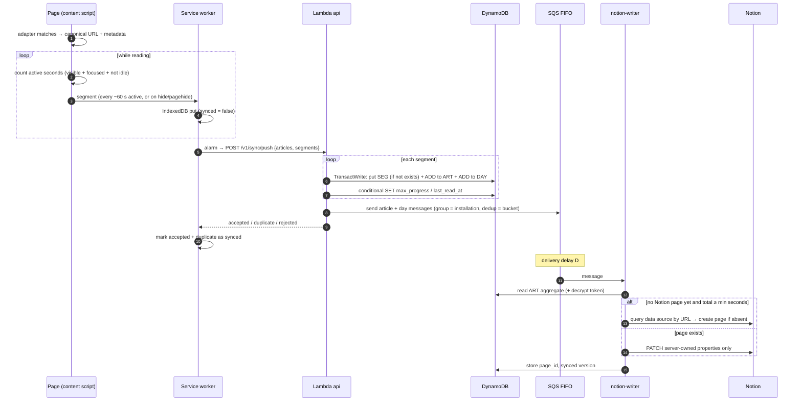
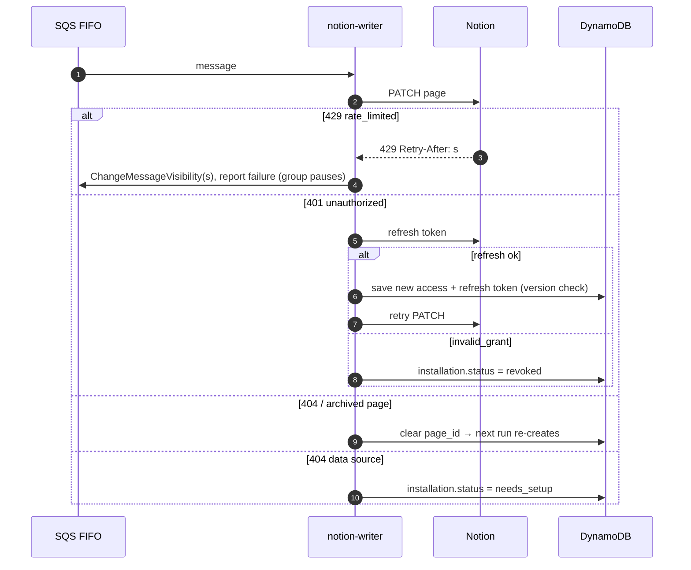
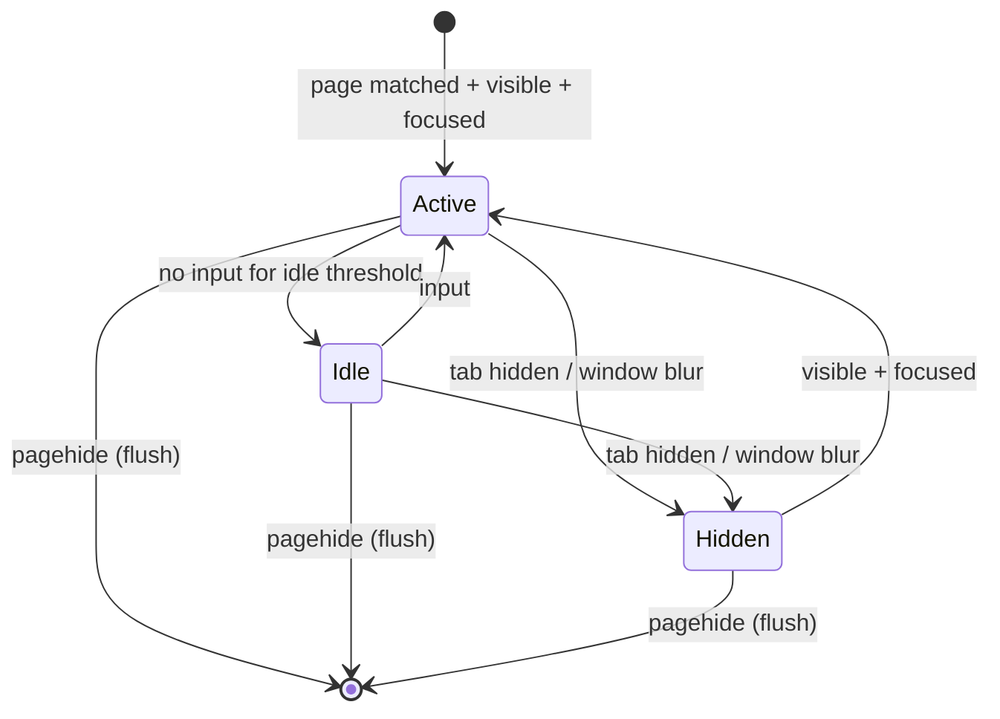
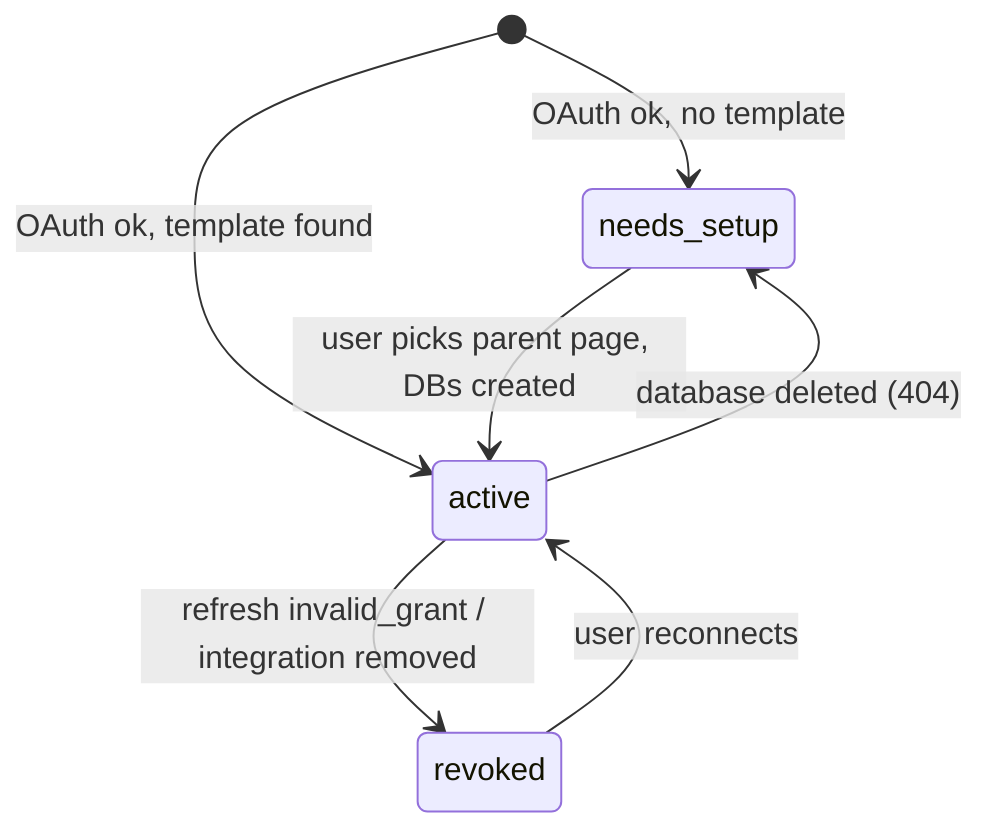
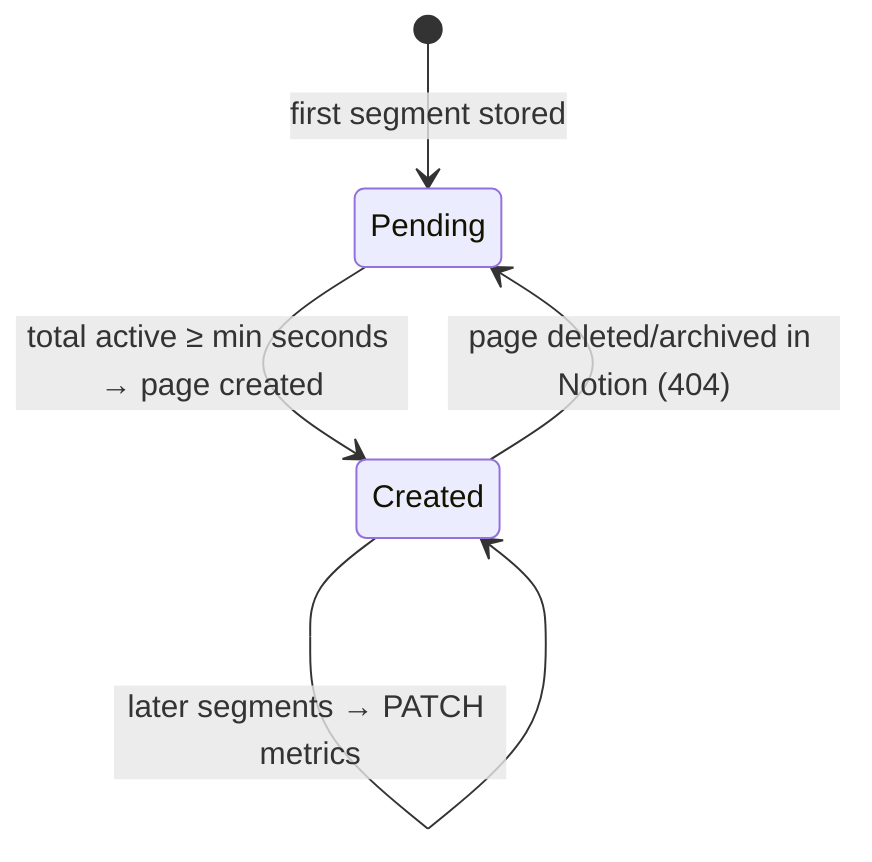

# Reading Tracker — Onboarding / Design

> **Purpose:** A Chrome extension that records what you read on the web (starting with Medium via the Freedium mirror, extensible to any source) and how long you *actually* read each piece, then files every article into the user's own Notion workspace as a searchable reading library. A small serverless Go backend on AWS sits in between to hold OAuth credentials and absorb Notion's rate limits.
> **Companion:** Build instructions (contracts, schemas, tasks) live in [`reading-tracker-agent-spec.md`](./reading-tracker-agent-spec.md).
> **Status:** Design chosen, not built. Items marked 🔶 OPEN are undecided — see §7.

---

## 1. Context & decisions

### 1.1 Goal

The author reads Medium through `freedium-mirror.cfd` and wants:

1. A history of every article read, with **active reading time** (not "tab was open" time), progress and number of sessions.
2. Support for **many sources**, not just Medium (Substack, dev.to, docs sites, arbitrary blogs).
3. A place to **search and review** that history comfortably — on desktop and mobile — without building a UI for it.
4. The integration usable by **other people** (public Notion integration), at **$0/month** running cost.

### 1.2 Scope of v1

| In v1 | Later (not v1) |
|---|---|
| Tracking on Freedium/Medium + user-enabled domains (generic adapter) | Dedicated adapters: Substack, dev.to, YouTube, PDF, arXiv |
| Active-time, progress, sessions, completion | Highlights & notes captured in-page |
| Sync to Notion: Reading Library + Daily Log | AI summaries, weekly digest, spaced-repetition of highlights |
| OAuth connect, template duplication, manual setup fallback | Notion → extension sync (webhooks) |
| Popup (today's time, current article, recent) + Options page | "✓ already read" badges on feeds, read-later queue, mobile capture |
| Account deletion | Stats dashboard beyond Notion views (🔶 OPEN, §7) |

### 1.3 Decisions and the alternatives we rejected

Each of these was debated; the table exists so nobody silently undoes them.

#### D1 — Where the reading library lives

| Criterion | PostgreSQL + own UI | SQLite on server | **Notion (chosen) ✅** |
|---|---|---|---|
| Search / filter / review UX | Must build | Must build | **Free: search, views, filters, mobile app** |
| Aggregations (time per week) | Native SQL | Native SQL | Not available — must pre-aggregate |
| Write throughput | High | High | **~3 req/s per connection** |
| User owns their data | No | No | **Yes, in their workspace** |

**Why Notion:** the point of the product is *looking back* at what you read. Notion gives search, filtering, tagging, rating, board/gallery views and a mobile app for free. The cost is that Notion is a poor time-series store and is rate-limited, which shapes the rest of the design (§4).

#### D2 — Sync direction

| | Two-way (Notion webhooks → extension) | **One-way: extension → server → Notion (chosen) ✅** |
|---|---|---|
| Moving parts | Webhook endpoint, handshake, HMAC verification, dedupe table, change log, SSE/pull channel, bot-loop suppression | **Push endpoint + queue worker** |
| What the user gains | Tags/rating set in Notion visible inside the extension | — |

**Why one-way:** all review happens in Notion anyway; showing Notion-side tags inside the extension wasn't worth roughly doubling the system. The design keeps the door open: because every Notion property has exactly one owner (see §4.2), webhooks can be added later without conflict logic.

#### D3 — Compute

| | Long-running Echo server (VM/container) | **AWS Lambda (chosen) ✅** |
|---|---|---|
| Idle cost | Always paying | **$0 inside Always Free** |
| In-memory rate limiter | Works | Doesn't — instances share nothing |
| Ops | Patching, uptime | None |

**Why Lambda:** traffic is tiny and bursty (a batch push every couple of minutes per active reader). We keep **Echo** as the HTTP framework by running it inside Lambda via `aws-lambda-go-api-proxy` (Echo adapter, payload v2), so handlers are ordinary Echo handlers and the app also runs locally as a normal server.

#### D4 — HTTP entry point

| | API Gateway HTTP API | **Lambda Function URL (chosen) ✅** |
|---|---|---|
| Cost | Free tier not guaranteed forever | **No extra charge** |
| Authorizers, throttling, custom domain | Built-in | Do auth in Echo middleware; custom domain needs CloudFront (🔶 OPEN) |

#### D5 — Server-side database

| | SQLite | PostgreSQL (RDS) | **DynamoDB, single table, provisioned 25/25 (chosen) ✅** |
|---|---|---|---|
| Works with Lambda | No (no shared disk) | Yes, but connection pooling + cost | **Native** |
| Cost | — | Not free long-term | **Always Free: 25 GB, 25 WCU, 25 RCU** |

**Why provisioned, not on-demand:** only provisioned capacity is covered by Always Free. A single table means all 25 units go to one place. Consequence: write paths must be frugal (transactions cost 2× WCU).

#### D6 — Respecting Notion's rate limit without shared memory

| | In-memory `rate.Limiter` | Distributed token bucket in DynamoDB | **SQS FIFO, `MessageGroupId = installation` (chosen) ✅** |
|---|---|---|---|
| Correct across Lambda instances | No | Yes, but costs WCU on every call | **Yes — FIFO processes one message per group at a time** |
| Debouncing bursts | Manual | Manual | **Free via deduplication IDs (§4.3)** |

#### D7 — Encrypting Notion tokens at rest

| | AWS KMS customer key | **App-level AES-256-GCM, keys from SSM Parameter Store → Lambda env (chosen) ✅** |
|---|---|---|
| Cost | $1/key/month + requests | **$0** (Standard parameters, AWS-managed `aws/ssm` key) |
| Risk | Key never leaves KMS | Key is in Lambda env and in Terraform state — mitigate with IAM + encrypted, private state bucket |

Key versioning (`v1:`, `v2:` prefixes) allows rotation without re-encrypting everything at once.

#### D8 — Infrastructure as code

**Terraform owns all infrastructure** (DynamoDB, SQS, Lambdas, Function URL, IAM, SSM reads, log groups, budget). **AWS SAM CLI is used only as a build/local-test tool** on top of the Terraform project (`--hook-name terraform`). We don't write a SAM template; having two IaC tools both declare resources would drift.

#### D9 — Notion integration type

**Public integration with OAuth 2.0** (not an internal token), because other people will use it. OAuth lets us offer a **template** that Notion duplicates into the user's workspace during authorization, so the databases exist with the right schema from minute one.

---

## 2. Glossary

| Term | Meaning |
|---|---|
| **Source adapter** | Extension module that knows one site family: whether a URL matches, how to get the canonical URL, metadata and the content root. |
| **Canonical URL** | The one stable identity of an article. For Freedium it's the *original Medium* article, so mirror-domain changes don't split history. |
| **Session** | One continuous visit to an article (open → leave). |
| **Segment** | A slice of a session flushed by the extension (e.g. every 60 s of active time, or on tab hide). Append-only, has its own UUID. The unit of sync. |
| **Active time** | Seconds when the tab is visible, the window focused, and the user interacted within the idle threshold. |
| **Installation** | One Notion authorization (identified by Notion's `bot_id`) for one workspace. Holds tokens and the IDs of the two databases. |
| **Reading Library** | Notion database, one page per article. |
| **Daily Log** | Notion database, one page per day with minutes read — small enough for Notion chart views. |
| **Server-owned / user-owned property** | Every Notion property is written by exactly one party. The server never touches user-owned ones. |

---

## 3. Architecture & actors

**Responsibilities and separation of duties**

- **Content script** measures; it never talks to the network. Measuring in the page is the only way to see scroll, visibility and interaction.
- **Service worker** is the only network client. It stores everything locally first (offline-first) and syncs in batches; losing connectivity or the server never loses data.
- **Lambda `api`** authenticates devices, writes reading data to DynamoDB atomically, and enqueues work. It **never writes reading data to Notion** — it only calls Notion for OAuth and one-time setup. This keeps request latency independent of Notion's rate limit.
- **Lambda `notion-writer`** is the only component that writes pages to Notion and the only one that refreshes Notion tokens. Because it runs one message at a time per installation, token refresh can't race (Notion rotates refresh tokens; two concurrent refreshes would invalidate one another).
- **Secrets:** the Notion client secret and encryption keys exist only in SSM and Lambda env. **The extension holds no secret** except its own revocable device token.

---

## 4. Core problem

> **Turn a noisy, high-frequency stream of reading measurements from many devices into a small number of correct, idempotent writes to a slow, rate-limited store (Notion) that the user is simultaneously editing by hand — on serverless compute that shares no memory, at $0.**

Get this wrong and you see one of: double-counted minutes (retries), lost minutes (debounce dropping the last update), 429 storms (parallel Lambdas), or the server overwriting the tags/status the user just set in Notion. The design resolves each of these deliberately:

### 4.1 Count every second exactly once

The extension sends **segments**, each with a client-generated UUID. The API writes the segment row *and* adds its seconds to the article and day aggregates in **one DynamoDB transaction**, conditioned on the segment not already existing. A retried push hits the condition, the whole transaction is cancelled, nothing is double-counted, and the API reports the segment as a duplicate so the extension can mark it synced. Segments are append-only, so there is nothing to merge.

### 4.2 Never clobber the user

Notion is the user's space. Every property has one owner:

- **Server-owned:** metrics (reading time, progress, sessions, completed, first/last read) and descriptive fields written once at creation (title, URL, source, author, site, word count).
- **User-owned:** Tags, Rating, Status, Notes. The server **never** writes these, not even at creation.

This is why completion is a separate `Completed` checkbox rather than the server flipping `Status` — otherwise reading 90 % of an article the user had marked "Abandoned" would undo their choice. It's also what makes adding webhooks later conflict-free.

### 4.3 Debounce and rate-limit with the queue itself

Every push enqueues a message to an SQS **FIFO** queue:

- `MessageGroupId = installation_id` → at most one in-flight message per installation, so each user's Notion connection is naturally serialized (and naturally paused while a 429 back-off is in effect).
- `MessageDeduplicationId = <type>#<installation>#<key>#<time bucket>` with a bucket of **B** seconds → all pushes for the same article in the same bucket collapse into one message.
- A queue-level **delivery delay D ≥ B** guarantees that by the time the message is processed, every push that was deduplicated into it has already landed in DynamoDB. (If D < B, the last updates of a bucket would be dropped until the next read.) B must also be ≤ 300 s, SQS FIFO's dedup window.
- The worker always **reads the latest aggregate** and writes absolute values to Notion, so processing twice is harmless.

The result: reading one article for an hour yields roughly 30 Notion writes instead of hundreds, and a user with many tabs can't starve others.

### 4.4 Fit Always Free capacity

25 WCU is small. A segment costs roughly 6 WCU (3-item transaction × 2) plus 1–2 WCU for the "max" updates. Segments are therefore coarse (≈60 s of active time), and pushes are batched. Provisioned tables have burst credit for short spikes; sustained overload returns a retryable error and the extension backs off.

---

## 5. How it works

### 5.1 Connecting Notion (first run)

Why a second hop (one-time code + PKCE) instead of putting the device token straight in the redirect URL: URLs end up in logs and history; the PKCE verifier proves the redeemer is the extension instance that started the flow.

If the user skipped the template, the Options page lists pages the integration can see and lets them pick a parent; the server creates both databases there.

### 5.2 Reading and syncing

### 5.3 Error paths

Revoked / needs_setup surface in the popup as "Reconnect Notion" / "Finish setup". Pushes keep being accepted meanwhile; nothing is lost, it's written once the installation is active again.

### 5.4 Lifecycles

**Tracker (per tab, in the content script)**

Only `Active` accumulates seconds. Transitions out of `Active` flush a segment if it has any seconds.

**Installation**

**Article in Notion**

---

## 6. Where things live

- **Build spec:** [`reading-tracker-agent-spec.md`](./reading-tracker-agent-spec.md) — exact API contracts, DynamoDB keys, Notion schema, task list, constraints.
- **Repo layout (planned):** `extension/` (MV3 + TS + Vite), `backend/` (Go: `cmd/api`, `cmd/worker`, `cmd/local`, `internal/…`), `infra/terraform/`.
- **Secrets:** SSM Parameter Store under `/reading/<env>/…`.
- **Runtime health:** CloudWatch Logs (7-day retention), DLQ depth, AWS Budgets alert at $1.
- **Notion template:** a public Notion page containing the two databases and default views; its URL is configured in the Notion integration settings.

---

## 7. Open questions

- 🔶 **Stats dashboard location.** Notion views + a Daily Log chart may be enough. If not: (a) inside the extension (offline, but only this device's local data unless we add a stats endpoint), or (b) a small static web app reading a `/v1/stats` endpoint (works anywhere, more surface). Depends on how much Notion charts satisfy in practice.
- 🔶 **Tracking thresholds.** Idle threshold (60–90 s), segment size (~60 s), minimum active time before a Notion page is created (~30 s), and the completion rule (progress ≥ 90 % and active time ≥ some fraction of estimated reading time). Defaults are reasonable; tune after real use. They're served from `/v1/config` so they can change without an extension release.
- 🔶 **Debounce bucket B / delay D.** Smaller = Notion updates sooner, more writes. Starting point B = D = 120 s.
- 🔶 **Custom domain.** The Function URL is stable as long as the function isn't recreated, but it's ugly and it's baked into Notion's redirect URI and the extension. CloudFront in front gives a stable custom domain (CloudFront has its own always-free allowance); adds one more resource.
- 🔶 **Freedium mirror list.** Mirrors change; the default list is bundled and overridable via `/v1/config`. Which mirrors to ship initially?
- 🔶 **Multiple workspaces per user.** v1 keeps one active installation per user (reconnecting to another workspace switches). Supporting several means routing each article to a chosen workspace.
- 🔶 **Device token lifetime.** Non-expiring until revoked (simple) vs. rotating (safer). v1 assumes non-expiring + revocation.
- 🔶 **Notion access-token expiry semantics.** The design refreshes reactively on 401; if Notion returns explicit expiry, refresh proactively in the worker.
- 🔶 **Lambda concurrency caps.** New AWS accounts can have a low account concurrency limit, which blocks `reserved_concurrency`. Fallback is SQS `maximum_concurrency` for the worker and relying on device auth for the API.

---

## 8. Appendix

- Notion API version pinned: **`2025-09-03`** (databases contain *data sources*; most database operations moved to `/v1/data_sources`).
- Notion limits: average **3 requests/s per connection**, plus a per-workspace limit; 429 with `Retry-After`. Rich text ≤ 2000 chars per item; ≤ 100 blocks per append.
- Notion OAuth: refresh tokens rotate — always persist the newest one.
- AWS Always Free (all accounts, no expiry): Lambda 1M requests/month, DynamoDB 25 GB + 25 WCU/RCU provisioned, SQS 1M requests/month. Accounts created after 2025-07-15 on the *Free plan* close after 6 months — use a Paid-plan account and stay within Always Free.
- References: [Notion — Authorization](https://developers.notion.com/docs/authorization) · [Notion — Upgrading to 2025-09-03](https://developers.notion.com/docs/upgrade-guide-2025-09-03) · [Notion — Request limits](https://developers.notion.com/reference/request-limits) · [Notion — Public integrations](https://developers.notion.com/guides/get-started/public-integrations) · [AWS Free Tier](https://aws.amazon.com/free/)

---
*Living document — update as 🔶 OPEN items resolve.*
